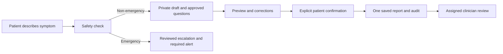
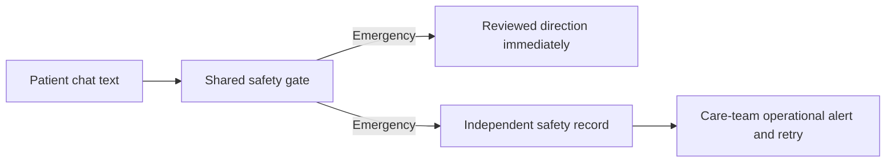

# PAT-002-B — Patient-confirmed symptom intake implementation plan

**Prepared:** October 10, 2026

**State:** B1–B11 implemented; requester-reported question approval, matching eligibility and authenticated local synthetic acceptance recorded October 12. PR #159 remains in review; no deploy or merge.

**Task:** PAT-002-B in [TASKS.md](../TASKS.md)

**Acceptance authority:** [Backlog requirements](project-backlog-acceptance.md#pat-002-b--guided-chat-symptom-intake-and-patient-confirmed-structured-report)

## 1. Request to carry into a new chat

Implement PAT-002-B using this plan and the repository's current AGENTS.md. First
inspect the actual checkout, current task board and linked requirements; this
document describes the October 10 starting point, not an immutable code inventory.
Preserve unrelated work. Deliver the confirmation boundary through the small,
ordered slices in section 12. Implement one slice at a time, explain and verify it,
then stop for the requester to follow along before starting the next slice.

Tushar owns PAT-002-B. Coordinate overlapping Chat and backend changes
with Ganesh's PR #136. B1's audit and B2's implementation are recorded in sections
17–18; no review is claimed.

### Follow-along instructions for every implementation session

The requester wants to understand what they implemented and why, and explain the
high-level flow themselves. This learning pace is part of the delivery contract.
Do not implement the entire plan in one turn or silently work on later slices.

**Before each slice**, give a concise explanation, normally no more than 150 words:

- The problem this slice solves and why it comes next.
- The part of the existing flow being changed, in plain language.
- One small Mermaid or text diagram when it clarifies a flow or data boundary;
  usually show only 3–6 relevant nodes rather than the whole architecture.
- The observable result and how it will be checked. State assumptions and any
  actual missing decision; explain technical terms when they first matter.

Implement the smallest coherent change for that slice, with its owning tests,
authorization/error behavior and documentation. Necessary supporting changes
belong to the current slice; substantial new work needs an explained scope change.
Do not defer safety, privacy or correctness to a final cleanup slice. If a proposed
slice is still overwhelming, split it further before implementing it.

**After each slice**, give a concise delivery explanation, normally no more than
250 words excluding verification steps:

1. **What changed and why:** the new behavior and the problem it fixes.
2. **How it flows:** trace one concrete synthetic action across the affected
   screen → authenticated API/socket → service → database, using a small diagram
   where useful. Identify where identity, safety, state or confirmation is checked.
3. **How to see it:** numbered steps, exact local test/API commands or click paths,
   and expected results. For a foundation slice with no UI, say so and show the
   focused test demonstration; never imply an unfinished screen exists.
4. **Verification:** what actually passed, any limitations/prerequisites and whether
   the result is local or deployed. Keep environment failures separate.
5. **How to explain it:** two plain-language sentences the requester can use to
   describe the implemented behavior and its purpose. Describe only completed work.
6. **Next slice:** its name and purpose, then stop. Wait for the requester to say
   “continue,” “start the next slice,” or otherwise explicitly advance the work.
   Answer questions/corrections about the current slice without treating them as
   authorization to start the next one. Do not start background work on later slices.

Keep explanations focused on product behavior, information movement and the
reason for each boundary. Mention filenames or detailed code only when they help
the requester locate or understand a change. Use the same terms consistently:
private draft, patient confirmation, confirmed report and clinician review.
Do not expose hidden reasoning or credentials in explanations or examples.

Update the current task state in TASKS.md and the relevant contract/acceptance
evidence after each slice. Keep the final flow diagram and explanation in this
specification current so the requester can revisit them; do not create a second
task tracker or scatter the learning material across unrelated files.

Do not apply remote migrations, reset/seed remote data, deploy, merge, or change
external configuration without explicit authorization for the particular action.
Prior scheduling rollout authorization does not authorize this feature's rollout.
After each delivered feature increment, explain the exact steps by which the
requester can see it working. Report dependency/environment failures separately
from feature failures. Keep implemented, locally verified, reviewed, merged and
deployed acceptance distinct.

## 2. Outcome and acceptance journey

A non-emergency patient describes a symptom to Nora, completes a bounded guided
intake, reviews what will be shared, corrects it if needed, and explicitly confirms
it. Until that confirmation there is no new clinician-facing symptom report and
no ADR processing from the draft. Confirmation saves exactly one attributable,
immutable clinical-content snapshot, available only to the patient and currently
assigned clinicians. An urgent safety override interrupts intake immediately.

```text
Patient symptom message
  → deterministic safety gate
      → emergency/self-harm: reviewed escalation, required care-team alert,
        no intake questionnaire or confirmation prerequisite
      → non-emergency: private persisted draft
          → approved missing-field questions + explicitly unknown/declined answers
          → preview: patient answers / retrieved record context / summary
          → correct / cancel / explicitly confirm
              → one atomic confirmed report + audit + permitted downstream work
```

Opening Chat, describing a symptom, accepting an extracted field or saving draft
answers is not confirmation. A chat utterance remains source evidence, not a
confirmed clinical fact. Patient confirmation is testimony, not clinician approval
of a diagnosis, medication link or ADR conclusion.

## 3. Verified starting point and gaps

| Current surface | What exists | Change required for B |
| --- | --- | --- |
| `backend/src/app/routers/chat.py` | Symptom route calls `analyse_symptom`, immediately writes `symptom_reports`, and can delegate to pharmacovigilance | Route to draft intake instead; stop report creation and ADR handoff before confirmation |
| `backend/src/app/followup/service.py`, `models.py`, `prompts.py`, `followup_copy.py` | Model extraction, generated follow-up question/reply, model-supplied required numeric severity, and copy saying the symptom was logged | Preserve useful extraction infrastructure, but restrict it to unconfirmed suggestions; use library questions and honest draft/confirmation copy |
| `backend/src/app/safety/triage_floor.py`, `escalation.py`, `adk/plugins/safety_floor.py` | Deterministic emergency/self-harm floor and localized reviewed responses | Preserve and invoke before every intake mutation/answer; do not rely only on the first chat turn |
| `services/chat_service.py` | Chat messages, conversation state and direct symptom-report insert | Reuse saved message IDs and state; retire the new-report bypass for this flow |
| `db/migrations/001_initial_schema.sql` | `symptom_reports` with mandatory severity 1–10 and basic flat fields | Support explicitly unknown severity and a confirmed snapshot without inventing a number |
| `db/migrations/002_rls_policies.sql` | Patient INSERT policy for symptom reports; assigned clinicians may read reports and chat | Audit effective later grants/policies, remove direct report-write bypass, and enforce private intake data |
| Patient Chat | `use-patient-chat-session.ts`, `services/chat-api.ts`, `services/chat-bridge.ts`, Redux chat state, saved profile language | Add guided intake panel and events using current transport/state patterns |
| Patient Symptoms | Honest handoff to Nora; Today already opens Chat | Keep entry behavior; do not fabricate history or implement C's timeline |
| Clinician deep dive | Reads symptom rows and raw chat; symptom display and ADR cards assume numeric severity | Expose confirmed report summaries with truthful confirmation/unknown labels and prevent intake leakage |
| Risk, SOAP, MCP and cron consumers | Read symptom rows; cron can flag linked medication rows; some code coerces missing severity to zero | Audit eligibility, unknown handling and new-report confirmation checks across all consumers |

Read before editing: AGENTS.md; TASKS.md and its active PAT-005 plan; PROJECT.md;
TEAM.md; ARCHITECTURE.md; CODING_STANDARDS.md; DESIGN_SYSTEM.md; CONTRIBUTING.md;
backend and both relevant portal READMEs; `docs/supabase_setup_guide.md`;
`docs/clinical-facts-provenance.md`; `docs/decisions/ai-runtime-2026-09.md`; and
adjacent source/tests. Follow any applicable nested instructions. Patient portal
instructions also route Next.js work to its installed package documentation.

Existing tests worth extending include:

- `backend/tests/unit/followup/test_symptom_service.py` and `unit/services/test_chat_service.py`.
- `backend/tests/unit/safety/test_triage_floor.py`, `test_safety_copy.py`, and `unit/adk/test_safety_floor_plugin.py`.
- `backend/tests/integration/routers/test_chat_emergency_copy.py`, `test_chat_websocket_stability.py`, `test_patient_api.py` and adjacent clinician tests.
- Patient `chat-page.test.tsx`, `chat-api.test.ts`, `chat-bridge.test.ts` and `symptoms-page.test.tsx`.
- Clinician deep-dive, symptom display, ADR and service tests affected by confirmed/unknown fields.

### PR #136 and migration coordination

As observed October 10, PR [#136](https://github.com/sjsu-masters-projects/medi-agent/pull/136)
is open and conflicting, at head `b0532e8`. It implements answers requested for an
existing ADR draft; B creates the initial patient-confirmed symptom report. B can
proceed from current main without waiting for #136. Recheck its state before coding
and coordinate overlapping patient Chat/model/schema changes; do not merge or
cherry-pick that PR merely to implement B.

The local checkout contains migrations through prefix `048`; #136 independently
adds `047_adr_patient_information_loop.sql`. These are not interchangeable. Choose
the next appropriate full migration filename after inspecting current main and
pending work; do not hardcode a filename/count from this plan. Preserve all applied
filename/checksum pairs. A local file count does not prove remote schema state.

## 4. Scope and defaults

Deliver guided text-first intake inside the Nora view, persisted patient-private
drafts, versioned approved questions, bounded evidence retrieval, provenance-aware
preview, correction/cancellation, atomic confirmation, safe existing clinician
summary visibility, authorization/RLS/audit and retry/recovery behavior.

Voice transcripts that already enter the shared text path must follow the same
draft/confirmation rules. Spoken assent or a transcription must never confirm a
report automatically. A full voice intake interface remains VOI-001.

Do not implement PAT-002-C's patient timeline/full clinician report workspace,
PV-001's complete reassessment or #136's follow-up panel, PV-002 MedWatch drafting,
new care-plan publication, automatic medication changes, external notifications,
new model providers, or a second conversation system. Keep existing scheduling,
approved Today instructions and human message threads intact.

Recommended implementation defaults, adjustable only with a documented reason:

- One active intake per patient and chat session; one report per intake.
- One approved question at a time, with a visible review action after required
  questions are explicitly answered, unknown or declined.
- A deterministic hard budget of at most 12 guided questions per intake. Group
  product-exposure subfields into an approved compact form rather than an unlimited
  interview. Questions are counted by stable IDs; no repeating unknown/declined
  questions or creating new IDs to evade the cap. At the cap, offer an honest
  incomplete preview with unanswered optional details retained, not guessed.
- No silent draft expiry in B. Save explicit abandonment as cancelled and permit
  authenticated recovery of the active draft after refresh.
- No optional intake model step is required to confirm correctly entered answers.
  A failed extraction generates no candidate values; use a deterministic manual
  entry path only when its approved library is available, otherwise show unavailable.

## 5. Approved question library and answer semantics

### Library contract

Start with a versioned repository resource, for example
`backend/src/app/followup/question_library/`, and an approval manifest. Avoid a new
question-authoring product or database registry unless an existing review mechanism
requires it. Each bundle needs an immutable version/hash, schema version, status,
real approval reference, reviewer role/identity and approval date, supported locales,
question IDs, answer types, applicability rules, required/optional classification,
and question budget. Never fabricate an approval or reviewer signature.

Only approved, complete en-US/es-MX bundles can be selected for live intake. Pin the
selected version to the draft; a later library update must not change an in-flight
or confirmed intake. A revoked library blocks further non-emergency progression
and confirmation under that bundle with an explanatory recovery path. It must never
block safety escalation. A replacement is explicit and audited, with a new preview.

Prepare question wording for the repository's required safety/clinical review.
For the synthetic demonstration, genuine review by the designated role/process
must be recorded; recruiting a real clinician is not an expo gate. Implementation
and synthetic tests can proceed with clearly labelled test approval fixtures, but
those fixtures do not authorize live library publication. If no approved bundle
exists, report that activation prerequisite rather than treating drafted copy as
approved. Exact clinical wording/branch criteria are review inputs, not invented
medical rules supplied by this plan.

### Required coverage

The library must cover the acceptance contract through applicable, bounded branches:

- Symptom/event description, body location, onset, duration, course, severity,
  associated symptoms and reviewed red-flag questions.
- Patient-supplied suspected product/exposure: name, strength, dose, route,
  indication, start/stop/change dates; no inferred suspect medication.
- Concomitant products, relevant patient-reported history/tests and outcome.
- Only approved symptom-specific branches, such as skin, gastrointestinal,
  respiratory, neurologic or medication-use-error details.

Avoid asking every product/history question for a symptom with no patient-supplied
product concern. Preserve applicability evidence and skip reasons. Newly authored
clinical branches that are not approved stay unavailable, not generated by a model.

### Answer contract

Use explicit states: `answered`, `unknown`, `declined`, `not_asked`, and
`not_applicable`. Retain value, patient wording, question ID, source type, source
message reference where applicable, locale and capture time. Do not convert
unknown/declined into “no,” empty strings, severity zero or model estimates.

Severity is a patient-selected rating or unknown/declined, not a model judgment.
An extractor may offer an explicitly stated number for review but cannot infer one
from adjectives, danger signs or a document. Keep descriptive wording separately.
Record dates as the patient stated them; any normalized date needs an explicit
patient acceptance and patient timezone context, not a fabricated precise instant.

Models may propose bounded extraction from patient words, not generate questions,
choose medical advice, assert causality or fill patient answers from records.
Patient corrections override suggestions, and every model-origin field remains
labelled as a suggestion until the patient accepts or replaces it.

## 6. Safety before intake and on every answer

1. Evaluate the existing deterministic floor before retrieval, extraction, next
   question selection or draft mutation. Fix the current emergency branch so it
   does not run symptom extraction/ordinary intake before displaying escalation.
2. Evaluate every answer, free-text correction, imported transcript and confirmation
   request. A form answer is not exempt because it bypasses the chat WebSocket.
3. Structured positive red-flag answers must map to reviewed deterministic rules;
   do not run keyword matching on isolated “yes” without its question context.
   Preserve the existing negation/current-versus-historical safety behavior.
4. Emergency/self-harm direction and its required care-team alert must not wait on
   model generation, report persistence or completion of a questionnaire. Stop the
   ordinary intake, retain safe existing draft state, and record an interrupted
   safety outcome. Alert failures are retained for retry and never reported as sent.
5. Persist the minimal rule ID/version, result, evaluation time and escalation
   delivery state needed for audit. No private reasoning, raw prompts or provider
   traces. A safety verdict is not patient-reported symptom severity. “No existing
   floor rule matched” is not a clinical clearance; unanswered/unknown red flags
   remain visible and are never represented as negative findings.
6. Use existing reviewed localized safety copy. A generic “try later,” draft-saved
   acknowledgement or secondary chat notice must not replace/downgrade it.

Do not invent new thresholds or hotline copy here. Any library-specific red-flag
mapping/copy changes require the established review and paired-locale fixtures.

## 7. Retrieval, attribution and privacy

Use existing patient-authorized medication/document/clinical-fact services, with
explicit intake purpose. Retrieve only context relevant to the patient-supplied
topic. Do not feed the whole chart or unrelated focused document to extraction.

Set and test deterministic budgets. Proposed initial ceilings: four medications,
five approved clinical facts and at most two exact cited excerpts of 500 characters
each, further bounded by the runtime route's context budget. These are upper limits,
not targets. A no-retrieval path still records purpose/version and an empty result.

Record an immutable retrieval snapshot per relevant revision: fact, citation,
document/source and medication identifiers; source versions and approval state;
purpose; library/rule version; retrieval time; and only the exact bounded content
actually used where needed for reconstruction. Recheck authorization/source
visibility on retrieval and read; a stored snapshot cannot bypass withdrawal or
access revocation. Do not store hidden model prompts or a second database dump.

The preview has three distinct sections:

1. **What you reported:** original answers and explicit unknown/declined fields.
2. **Relevant information from your record:** cited, read-only context; not testimony.
3. **Summary for your care team:** a separately identified, source-supported summary.

Prefer a deterministic summary assembled from confirmed fields. Optional generated
summary text must be grounded, bounded and visible for acceptance; editing answers
invalidates/rebuilds that preview. Never overwrite a source document, canonical
medication or earlier report when correcting the intake.

Keep draft answers, draft snapshots and unconfirmed summaries out of clinician
deep-dive, SOAP, risk, MCP tools, notifications, delegated tasks and clinician-readable
conversation-state projections. Intake form answers should be stored in the private
draft ledger, not mirrored into clinician-readable generic chat messages.

Audit the existing raw-chat access separately: assigned clinicians currently read
chat messages. Do not promise that the initial ordinary chat utterance is private
under that policy. Any newly persisted intake-specific question/answer or preview
message must be excluded from clinician projections and corresponding direct RLS
reads until eligible confirmation. If intake content is stored in chat, add a scoped
visibility marker/link and matching policies; hiding it only in the UI is inadequate.
Do not retroactively relabel or delete existing chat history.

## 8. Data model and migration design

Write one coherent additive migration for the confirmation boundary, or narrowly
split only if rollout sequencing requires it. Do not edit applied migrations.
Reuse existing `symptom_reports` as the downstream report identity to preserve ADR
foreign keys, rather than creating a competing report table.

| Entity | Proposed contents and ownership |
| --- | --- |
| `symptom_intakes` | Patient ID, conversation session key, saved originating user-message ID, status, revision, pinned library/hash, locale/timezone, private answer ledger, suggestions, retrieval snapshots, safety snapshot, preview revision/hash, timestamps and optional confirmed report ID |
| `symptom_reports` additions | Unique intake reference, report schema version, explicit confirmation state/origin, immutable confirmed content including testimony/context/summary/provenance, confirmation actor/time and submitted/review-pending status |
| Intake/report audit | Append-only start, answer/correction, preview, cancellation, safety interruption, confirmation and permitted downstream handoff events; actor/time/revision and bounded reconstruction data |
| Existing task/outbox infrastructure | Only eligible post-confirmation review work or required safety alerts; durable dedupe identity and delivery/retry state |

Draft states: `collecting → ready_for_confirmation → confirmed` or `cancelled`;
an emergency moves the intake to `interrupted_safety`. Any answer correction from
ready returns to collecting and invalidates the preview. Confirmed/cancelled drafts
cannot be edited/reopened. A later correction becomes a linked new intake/report,
without implementing C's full correction timeline in B.

Enforce uniqueness for one active intake per patient/session, one intake per saved
originating message, and one report per intake. Keep an optimistic integer revision
for every mutation. Use JSON checks/size limits and foreign keys plus same-patient
checks for source messages, medication and citation references; existence alone is
not ownership. A session string alone is not a globally unique source-turn ID.

Allow `severity = NULL` for unknown/declined new reports and preserve the 1–10 check
when present. Update Pydantic/shared/client types and affected consumers accordingly.
Do not populate zero or force an estimate to satisfy the old NOT NULL constraint.

Historical symptom rows have no patient confirmation proof. Mark them
`legacy_unconfirmed` (or equivalent explicit origin) without rewriting clinical
content or fabricating confirmation actors/times. Preserve existing ADR links and
review history. Show legacy context truthfully, not as newly patient-confirmed data;
new confirmed-only consumers exclude it unless an explicitly documented legacy
compatibility path is required. No automatic promotion or destructive backfill.

Keep confirmed clinical content immutable through database protection, not just
client controls. Operational review/delivery/ADR-candidate fields may change only
through authorized audited paths and must not rewrite testimony/context/summary.
Inspect the existing cron's flag mutation when defining that separation.

## 9. Authentication, RLS and atomic confirmation

Patient endpoints derive patient identity from the authenticated session; ignore or
reject client-supplied actor/patient/clinic identities. Clinician reads require
current active assignment on every request, including after reassignment. Follow
existing non-enumerating denial behavior and authorization-denial audit patterns.

Enable RLS on drafts/audit/new infrastructure. Draft SELECT is patient-owner only;
clinician and anonymous roles cannot read or mutate drafts. Confirmed report reads
are patient-owner or actively assigned clinician only, using hardened private helper
patterns and least-privilege grants. Audit visibility must not reveal private drafts.

Revoke direct browser report/intake INSERT/UPDATE/DELETE and arbitrary confirmation
RPC execution, including the old symptom-report INSERT policy/grants where effective.
Service-role-only RPCs still validate ownership, source scope, revision, state and
payloads; bypassing RLS is not authorization. Add database enforcement preventing
new confirmed rows through the retired direct insert path or forged confirmation.

The confirmation service first rechecks safety and prepares validated content.
Its transaction then:

1. Locks the owned intake and checks active status, expected revision, the pinned
   approved library reference/hash and the exact current server preview/version/hash.
2. Validates source ownership and the explicitly accepted preview; the client cannot
   submit an arbitrary replacement report, actor/time or summary.
3. Inserts one immutable report with patient identity, answers, source message IDs,
   context/summary attribution, locale, safety evidence and server confirmation time.
4. Marks the draft confirmed, associates its report, appends confirmation audit, and
   records any permitted deduplicated downstream task/outbox entry atomically.
5. Returns the authoritative report ID and saved status.

Any failure rolls back all these effects. A notification or worker outage after
commit must not lose the report, undo confirmation or make the patient re-confirm.
Use existing durable task patterns where adequate; add a minimal outbox only if
they cannot close the save-before-enqueue gap. Never call a model/network provider
inside a database transaction.

Library eligibility is validated by the service before the RPC; SQL cannot read
repository bundle files. If live revocation is supported across deployed versions,
store only the necessary manifest eligibility in the existing approval store or a
minimal database manifest so the transaction can recheck it. Do not add a library
authoring interface or pretend a browser-supplied approval flag establishes approval.

Use a client-generated stable confirmation UUID plus payload/preview identity.
Same key and same preview returns the original report; a changed payload/preview
with that key returns conflict. Concurrent distinct confirm keys for one intake
must still resolve to one report, never a second insertion. Cancel versus confirm
is serialized; the loser sees the authoritative final state. A stale revision is a
conflict requiring reload/review, not a silent overwrite.

## 10. Proposed API and socket contract

Finalize names against current router conventions in the first implementation
increment; these are proposed contracts, not endpoints claimed to exist today.
Keep routers thin and put behavior in a dedicated `SymptomIntakeService`, with
focused repository/query helpers where existing patterns support them.

| Proposed endpoint | Purpose |
| --- | --- |
| `GET /api/v1/patients/me/symptom-intakes/active?session_id=…` | Recover the current owned intake after refresh/reconnect; no clinical content in URL |
| `GET /api/v1/patients/me/symptom-intakes/{id}` | Authoritative draft state/revision, or final linked report state |
| `POST /api/v1/patients/me/symptom-intakes` | Idempotent start from an owned saved chat message/session; internal chat path uses the same service |
| `POST /api/v1/patients/me/symptom-intakes/{id}/answers` | Save one approved answer/correction with expected revision and stable mutation ID |
| `POST /api/v1/patients/me/symptom-intakes/{id}/preview` | Validate readiness/safety and create server-bound review snapshot |
| `POST /api/v1/patients/me/symptom-intakes/{id}/confirm` | Explicit consent, preview/revision binding and atomic confirmation |
| `POST /api/v1/patients/me/symptom-intakes/{id}/cancel` | Idempotent abandonment; no confirmed report or ordinary clinical handoff |
| `GET /api/v1/patients/me/symptom-reports/{id}` | Read confirmed success/recovery summary; not a patient timeline |

Existing assigned-clinician patient detail/deep-dive should expose an appropriately
bounded confirmed report summary with confirmation/provenance labels. Add a small
authorized report read endpoint only if that existing contract cannot support B's
acceptance; defer full detail workflow and status transitions to C.

Responses include `intake_id`, status, revision, pinned library version, current
approved question, bounded progress, and explicit action availability. Preview
includes its revision/hash and provenance sections. Return stable error codes for
not found/access denied, validation, revision conflict, cancelled, unavailable
library, safety interruption and uncertain/unavailable persistence. No raw English
server/provider messages in patient UI.

Add typed socket events such as `symptom_intake_updated` with intake ID/revision
and `symptom_intake_interrupted` with reviewed safety outcome. Carry only owned,
bounded state, never hidden reasoning. REST recovery is authoritative if an event
is missed; dedupe events by ID/revision. Preserve existing assistant start/chunk/
complete lifecycle so intake does not leave the chat typing forever. Do not depend
on PAT-001-A's future general turn-recovery implementation.

## 11. Patient UI and existing consumer changes

Add an intake feature component, service client, small state hook/reducer and
`content/symptom-intake-copy.ts` using established resource patterns. Reuse shared
contracts under `packages/shared` where both portals genuinely consume them.

Inside Nora, show “Draft — not submitted,” the approved question, unknown/decline
choices, patient-entered values and review/cancel controls. Keep the Chat composer
available for safety-bearing text; ordinary text can update suggestions only through
the owned intake service and cannot create a second automatic report.

The preview shows the three provenance sections, edit controls and a deliberate
**Confirm and share with my care team** action. Confirmation is a separate explicit
control, not an inferred “yes,” automated LLM tool call or transcript. On success,
show the saved report ID/status and no promise of continuous monitoring or an ADR
diagnosis. On cancellation, distinguish ordinary chat history from the cancelled
private intake; do not claim the whole conversation was deleted.

Translate questions, progress, statuses, labels, empty/loading states, preview,
confirmation, cancellation and error/retry copy into en-US/es-MX. Use the saved
shared patient profile locale. Do not translate historic patient answers, source
excerpts or confirmed reports when UI language changes; record answer locales and
let an in-flight draft preserve its pinned question versions across language changes.
Retain loading/failure/retry behavior for profile/settings and explicitly labelled
UTC fallback for invalid/missing timezone; browser timezone must not determine times.

After a timeout, keep the exact pending confirmation identity/preview, inspect
authoritative intake/report state, and offer explicit retry only if needed. No new
UUID for an uncertain save and no automatic write retry through generic API transport.
Late replies from an earlier authenticated session cannot restore its private data.
Clear client draft/preview state on sign-out/session change and abort stale requests;
do not persist clinical form content in localStorage or analytics.

Regress narrow screens (320px), desktop, keyboard focus, labelled controls and
live status feedback. Keep care-team human threads and #136's separate future ADR
panel distinct; do not mount this intake inside human messaging.

Audit `clinician_service.py`, `risk_score_service.py`, `soap_note_service.py` and
prompts, `cron_service.py`, `a2a_task_service.py`, `mcp/supabase_server.py`, both
portals' types/mappers, symptom chart and ADR cards. New processing accepts only
confirmed reports; null severity does not crash or become a patient-reported zero.
Do not plot unknown severity as zero or label it mild. Preserve existing risk-score
behavior only with truthful data-availability handling; fixing broad Risk Radar
explanations remains CLN-002, but new nullable reports must not introduce false
known values or failures. Regression-test any legacy compatibility branch.

## 12. Ordered implementation slices

The earlier six broad increments are replaced by the eleven smaller slices below.
Start with B1 only. Each slice has its own explanation, focused checks and learning
checkpoint. Pause after delivering each one, as section 1 requires.

| Slice | Small implementation scope | What the requester can follow and verify |
| --- | --- | --- |
| B1 — Trace the current flow | Inventory symptom writes/readers/grants and source-turn IDs; finalize draft/report states and interface contracts. Document the current and intended flow before coding feature behavior. | Walk one existing symptom turn from Nora to the immediate report insert/ADR handoff. Identify exactly where confirmation is missing. Show the proposed replacement and the task's boundaries. No UI or feature completion is claimed. |
| B2 — Safety takes priority | Extract/reuse the deterministic safety gate for all planned intake entry points. Stop emergency turns from running ordinary symptom intake; preserve reviewed escalation and required alerts. | Existing bilingual safety tests demonstrate that an emergency gets reviewed direction before questions, retrieval or model work. Explain why an emergency alert is independent of a confirmed symptom report. |
| B3 — Approved questions and truthful answers | Implement the versioned library loader, deterministic missing-field selection, question budget and answered/unknown/declined semantics. Define the draft candidate schema without inferred numeric severity. | A focused synthetic test shows the next approved question, skips already answered/declined fields and stops at the budget. Show that a document/model cannot answer for the patient. Library activation still requires genuine approval. |
| B4 — Store a private draft | Add the migration and owned intake start/read/answer/cancel service/API, revisions and audit. Establish report confirmation fields, unknown-severity compatibility and least-privilege permissions. Plan mixed-version activation explicitly. | Disposable SQL/API tests show a draft survives reads, another patient/clinician cannot access it, cancellation creates no report and stale updates fail. Explain patient identity resolution and why drafts and reports have separate storage states. |
| B5 — Nora starts a draft | Replace automatic symptom report creation/ADR handoff for the new flow; emit typed intake events and mount a bilingual draft panel in Nora. Add authoritative draft loading on entry/reconnect. | Enter a reviewed non-emergency synthetic symptom in local Chat and see “Draft — not submitted.” Refresh to recover the same draft. Verify zero new report/ADR work and unchanged human-message separation. |
| B6 — Answer, correct and cancel | Wire approved guided questions to private answer mutations, unknown/decline options, editing, progress and cancellation. Run safety checks on every form answer/correction. | Complete a few relevant questions, correct an answer, choose unknown/decline, then cancel. Verify saved state and no clinician report. Introduce a reviewed safety-bearing fixture midway through intake and show the interruption. |
| B7 — See the exact preview | Add bounded authorized retrieval snapshots and a server-bound preview with separate patient answers, cited record context and summary. Edits invalidate the previous preview. | Open review and identify where every displayed value came from. Correct a value and verify the new preview changes while source documents remain untouched. Confirmation remains unavailable until B8's transaction is ready. |
| B8 — Confirm exactly once | Implement atomic confirmation, immutable content, server actor/time, preview/revision binding and stable retry identity; enable the explicit patient confirmation control and authoritative success read. Include all compatibility changes needed to safely read the new report shape. | Confirm a preview and get one report ID. Real SQL tests prove rollback, duplicate retry, concurrent confirmation and confirm/cancel races. Show why a lost response cannot create a second report. Downstream clinical work stays gated until eligible integration is tested. |
| B9 — Share with the assigned clinician | Integrate the minimal confirmed summary into existing clinician views; enforce active assignment and confirmed-only downstream eligibility across SOAP/risk/MCP/cron/ADR paths. Wire any permitted durable review handoff without creating a clinical verdict. | The assigned clinician sees the confirmed summary and unknown labels; an unassigned/reassigned clinician is denied. Drafts remain absent from all clinical consumers. Explain patient testimony versus clinician assessment. Full timeline/detail remains C. |
| B10 — Recover across interruptions | Complete the remaining end-to-end recovery/accessibility matrix: missed events, lost responses, session/account switches, delivery outages and bilingual narrow-screen flows. Add only fixes justified by these integration cases. | Run named failure scenarios and show the same owned draft/report recovering without stale-account content or duplicate effects. Recheck language, timezone, touch/keyboard and voice-to-text confirmation boundaries. |
| B11 — Verify the full journey and prepare delivery | Run required integrated checks and regressions, finalize architecture/contract/acceptance docs and the C handoff, and prepare the review/rollout checklist. Remote rollout remains separately authorized. | Demonstrate the complete synthetic journey, explain the final architecture in a short overview and record exactly what passed. Distinguish implementation, local verification, review/merge and deployed acceptance. |

Build en-US/es-MX copy and owning tests with each applicable slice, not as a final
translation/testing batch. Idempotency, race protection, safety and access rules
must be correct when their mutations first exist; B10 extends recovery coverage,
it does not postpone those requirements. B9 must not be the first time a new null
severity can be read safely. If a consumer cannot yet accept the new shape, keep
that integration unavailable until its compatibility checks pass.

Earlier slices may be demonstrated with focused tests or a disposable local
database while live library/schema prerequisites remain unmet. Keep incomplete
intake activation gated and explicitly labelled; never deploy a partial confirmation
boundary or revert to automatic report saving when the new path is unavailable.
Do not add a live-looking mock to manufacture an observable checkpoint.

These are checkpoints within PAT-002-B, not eleven new top-level issues, separate
clinical approvals or claims that a partial panel completes the feature. Use a
cohesive branch such as `feature/confirmed-symptom-intake` from current main and
preserve unrelated work. Do not expand into C merely to make B's demo look complete.

### Cumulative flow to explain at the end



Use only the portion affected by the current slice in its explanation. At final
delivery, provide a short account of the problem, the flow and the key choices:
why drafts stay private, why questions are approved, why the patient confirms,
why saving is atomic, and why clinician judgment stays separate.

## 13. Verification matrix

| Area | Required cases |
| --- | --- |
| Confirmation boundary | Initial message, saved answers and preview create no report; correction invalidates old preview; explicit current confirmation creates one report; cancellation creates none |
| Question selection | Missing applicable fields only; approved IDs/copy only; both locales; no duplicate questions; unknown/declined retained; hard budget; unsupported/unapproved/revoked library recovery |
| Patient testimony | No inferred numeric severity/medication link/dates; patient-supplied unlisted product remains text rather than another patient's medication ID; citations never fill an unanswered patient question |
| Safety | Existing bilingual emergency/self-harm fixtures; model disabled/timeout; structured red-flag answer; new emergency on correction/confirmation; mixed historical/current/negated signals; alert failure never suppresses direction |
| Preview and evidence | Patient answers/context/summary separated; edits rebuild exact preview; retrieval caps/version/citations recorded; unauthorized/withdrawn source does not leak; no prompts/provider traces |
| Authorization | Patient A versus B for start/read/answer/preview/confirm/cancel; source message/session/medication/citation mismatch; assigned/unassigned/cross-clinic/reassigned clinician; anonymous/browser mutations and RPC execution denied |
| Real SQL transactions | One active draft; stale revision; duplicate answer mutation; same-key repeat; same-key changed payload; simultaneous distinct confirmation keys; confirm/cancel race; injected audit/task failure rolls back; confirmed content immutable |
| Recovery | Reload/reconnect resumes owned draft; lost socket event recovers by REST; confirmation commit with lost response returns same report; failed follow-up delivery remains retryable without a second confirmation; account switch discards stale UI/results |
| Consumers | No private draft in clinician detail/chat projections, SOAP, risk, cron, MCP or ADR tasks; no null-to-zero report/chart mapping; legacy rows retain history and honest unconfirmed origin |
| Regressions | Nora/document focus, human messaging, Today/barriers, scheduling, existing ADR review/#136 compatibility if integrated, and existing voice text fallback remain functional |
| Interface | English/Spanish headings/questions/errors/buttons, unknown/decline/edit/cancel/confirm, keyboard/mobile, honest saving/uncertain-save states and saved timezone independent of browser |

Prefer existing disposable PostgreSQL fixtures; add focused
`tests/integration/test_symptom_intake_postgres.py` with an explicit synthetic/local
opt-in if needed. It must never read a configured remote DB URL. Test actual SQL
locks, constraints, roles and RPC permissions, not just fake Supabase calls or SQL
string assertions. Native PostgreSQL absence/macOS limits are environment failures;
a skipped SQL test is not a passed authorization/concurrency check. Use an already
available isolated container alternative only through repository-supported patterns.

## 14. Required commands and evidence

From the backend directory, use the existing locked environment (Python 3.12
recommended by the current locks) and run:

```sh
PYTHONPATH=src .venv/bin/pytest tests/unit/followup tests/unit/safety tests/unit/adk/test_safety_floor_plugin.py tests/unit/services/test_chat_service.py tests/integration/routers/test_chat_emergency_copy.py tests/integration/routers/test_chat_websocket_stability.py --no-cov
```

Add the new intake service/API/library tests and affected consumer regressions to
the focused run once their final paths exist. Define/document the local SQL flag
before using the proposed command:

```sh
SYMPTOM_INTAKE_TEST_POSTGRES=1 PYTHONPATH=src .venv/bin/pytest tests/integration/test_symptom_intake_postgres.py --no-cov
.venv/bin/ruff check src/ tests/
.venv/bin/ruff format --check src/ tests/
.venv/bin/mypy src/ --ignore-missing-imports
.venv/bin/python scripts/validate_migrations.py
PYTHONPATH=src .venv/bin/pytest tests/ -v
```

From each changed portal directory:

```sh
npm run lint
npm run typecheck
npm run test
npm run build
```

Run the repository's required PR/CI checks, plus `git diff --check`. Do not alter
dependency locks or broad unrelated formatting to make the feature look green.
Record exact commands, outcomes/skips and evidence; distinguish unavailable
dependencies, credentials/model capacity and PostgreSQL startup from code failures.
Provider-independent synthetic fixtures are required; a live paid model probe is
not substituted for deterministic tests or authorized automatically by this plan.

## 15. Rollout and steps to see the feature working

No remote action is part of plan preparation or automatically part of implementation.
After code/library review and local verification, identify the exact target,
migration filename/checksum, pending migrations, library approval and compatible
backend/portal versions. Use the canonical migration ledger from the implementation
checkout after exact authorization, not an old root checkout lacking the new file.
Do not opportunistically apply #136 or unrelated pending migrations. Activate the
compatible backend/portals only after the schema/library prerequisites are met.

Ensure a mixed-version deployment cannot leave the old immediate-write backend
creating new clinician-facing reports around the confirmation constraint. Use an
existing feature gate or a narrowly documented intake activation gate if needed;
disabled/unavailable intake shows honest copy and never restores the old auto-save
path. Preserve historic data and approved care plans; rollback disables new intake
without deleting confirmed reports or relaxing the confirmation boundary.

Manual synthetic acceptance, after prerequisites are satisfied:

1. Sign into the patient portal as synthetic patient A. Confirm its saved language
   and timezone in Profile. Open Today → symptom shortcut → Nora.
2. Enter a reviewed non-emergency fixture containing a symptom and onset but missing
   severity/course. Verify a private draft appears, only applicable approved questions
   are asked, and nothing says a report or ADR has already been established.
3. Enter answers, use unknown/decline for selected fields, and refresh. Verify the
   same owned draft/revision returns. As A's assigned synthetic clinician, verify
   there is no new shared report or private intake preview in existing views.
4. Open review. Inspect the patient answers, cited record context and summary as
   separate sections. Correct onset or severity, then verify the old preview cannot
   be submitted and the new preview reflects the correction without editing records.
5. Click Confirm and share. Refresh/repeat an uncertain retry using the same identity.
   Verify exactly one report ID, explicit confirmation status/time and retained
   unknown/declined values. The assigned clinician can read the confirmed summary.
6. Start another intake and cancel. Refresh; confirm it stays cancelled and creates
   no ordinary report, ADR task or claimed clinical notification.
7. Repeat in Español (México). Verify approved question/UI copy, saved timezone,
   loading/error/retry states and original-language patient/source wording.
8. Use reviewed emergency/self-harm fixtures, including a new safety-bearing answer
   midway through intake. Verify immediate reviewed direction and the required
   alert path, without a questionnaire or confirmation delay. Do not use real events.
9. Use patient B and an unassigned/reassigned synthetic clinician to attempt A's
   draft/report/source reads and mutations. Verify denials and required denial audit.
10. Run the lost-response, stale-preview and concurrency cases in controlled tests;
    verify no duplicate report/audit/task and no partial commit. Recheck scheduling,
    human threads and existing ADR review as regression journeys.

The delivery report must state what was actually tested, target/commit identifiers
when known, remaining review/activation prerequisites and the exact click path.
Do not claim deployed acceptance from a local component test or author report alone.

## 16. Completion and handoff to PAT-002-C

Update TASKS.md, this plan/contract, ARCHITECTURE.md, affected app/backend READMEs
and the Supabase guide whenever the behavior or rollout changes. Keep verification
evidence in a focused acceptance document; avoid a second task tracker. Preserve
implementation attribution and never invent reviews or clinical validation.

PAT-002-B is ready for review only when the guided, bounded, bilingual path, safety,
patient preview/correction/cancel/confirm, immutable source-attributed report,
authorization/RLS, atomicity/idempotency and regression evidence are complete.
The approved question-library prerequisite must be explicit. Mark implementation,
merge and deployed verification separately; do not mark Done from a mock/form alone.

Leave C an explicit versioned report contract with report/intake IDs, confirmation
actor/time, original answer ledger/locales, source message/session references,
safety result, bounded cited context, separate summary, immutable clinical content
and safe submitted status. C adds the patient timeline, full clinician detail and
audited review/information-request lifecycle. PV-001 consumes confirmed reports;
it never scrapes raw chat or treats the private draft as confirmed testimony.

## 17. B1 — Source audit and interface contract (October 10, 2026)

This checkpoint documents inspected source, not a delivered intake screen or a
deployed security check. Work started from local `main` and `origin/main` at
`657602d28c8e8b6f954dee59203c7d25a7884225` (merged #141), on
`feature/confirmed-symptom-intake`. Existing unrelated working-tree edits were
preserved. The requester selected B1–B6 in order; this plan's per-slice learning
checkpoints still apply. B7–B11 are prerequisites to full PAT-002-B acceptance.

### B1 baseline symptom turn and missing confirmation

```text
Today → Nora → authenticated patient WebSocket
  → save ordinary user chat message, emit its database UUID
  → drug-knowledge retrieval → coordinator classification
  → symptom extraction and reply (mandatory model-supplied severity)
  → immediate symptom_reports INSERT
  → possible ADR delegated task keyed by the new report UUID
  → assistant completion, conversation-state update, possible care-team alert
```

For the synthetic phrase “I feel dizzy after starting metformin,” the coordinator
may select the symptom route. `routers/chat.py` calls `analyse_symptom`, whose
patient-evidence rules can identify an ADR candidate if the supplied product matches
an active medication. `ChatService.save_symptom_report` then inserts the report;
`A2ATaskService.run_symptom_to_pharmacovigilance` may consume it immediately.
There is no patient review, private answer ledger or explicit confirmation between
extraction and insertion. This is a conditional source trace, not a live-model run.

The ADK safety plugin protects reviewed emergency wording before its own model
execution. However, the router retrieves drug knowledge before that plugin and
still invokes `analyse_symptom` for medical-emergency symptom classifications.
An alert is independent of confirmation: B2 must interrupt ordinary intake and
deliver the reviewed direction without waiting for extraction or a report.
Existing alert writes are not a durable delivery/retry guarantee; that remains
required implementation work, not evidence supplied by current tests.

### Writers, readers and permission inventory

| Surface inspected | Observed behavior | Required boundary |
| --- | --- | --- |
| `routers/chat.py`, `services/chat_service.py` | Sole application report-insert path found; numeric 1–10 validation, no confirmation metadata | Replace with owned private-draft start; retire automatic insert without fallback |
| `followup/service.py`, `models.py`, `prompts.py`, `followup_copy.py` | Mandatory model severity, model follow-up question, logged acknowledgement, active-medication matching and ADR evidence | Bounded suggestions only; explicit patient severity, approved questions and honest draft copy |
| `services/clinician_service.py` | Deep dive reads all report rows and ordinary chat; ADR queue joins symptom severity | No private form answers/previews in either store/projection; truthful legacy/unknown labels |
| `services/chat_service.py` | Recent reports enter chat context | Exclude private drafts; preserve explicit legacy compatibility until its replacement is checked |
| `services/risk_score_service.py` | `int(row.get("severity", 0))` fails for present NULL; empty rows use zero internally | Filter known ratings and expose truthful availability; do not claim patient-reported zero |
| `services/soap_note_service.py` and SOAP prompts | Reads reports and raw chat for context | Draft ledger must stay absent; confirmed eligibility and legacy policy need focused checks |
| `services/cron_service.py` | Scans linked-medication reports, coerces missing severity to zero, updates ADR flag | Confirmed eligibility; separate operational flags from immutable testimony |
| `services/a2a_task_service.py` | Consumes caller report payload, coerces severity to zero | Confirmed source eligibility and nullable-safe candidate handling before handoff |
| `mcp/supabase_server.py` | Reads symptom rows; query includes `onset_date`, while schema uses `onset` | Audit authorized/confirmed query and correct the contract when integrating |
| `models/symptom.py`, shared `SymptomReport`, clinician mapper/chart/ADR cards | Numeric severity assumptions | Nullable types, unknown labels and chart gaps before nullable reports can be produced |
| `001_initial_schema.sql`, `002_rls_policies.sql` | NOT NULL severity, owner report INSERT policy; owner and assigned-clinician SELECT; assigned clinicians can SELECT ordinary chat | Add explicit confirmation origin; revoke browser report writes; separate patient-private drafts |
| `020_harden_database_security.sql` | Rewrites public policies to `authenticated` and private assignment helpers | Reuse hardened helpers; active assignment required on each clinical read |
| `027_grant_service_role_symptom_report_read.sql` | Explicit service-role SELECT grant only | New mutation RPC grants must be explicit and service-only, with ownership checks |
| `010_chat_state_and_a2a_tasks.sql`, `023_grant_service_role_a2a_task_access.sql` | Session-keyed state and report-keyed delegated tasks exist | Never put private answers/preview in shared state or enqueue ordinary ADR work from a draft |

The repository does not fully declare platform default table privileges. The
owner INSERT policy remains present after 020; 027 does not revoke it. Effective
remote grants were not queried, so no browser-write denial is claimed. B4 must
explicitly revoke browser mutations and test actual roles/RPCs in disposable SQL.
No intake/question-library implementation or approval manifest was found.

### Identity and source-turn decisions

- Patient IDs equal the authenticated user UUID in the current patient profile
  contract. New `/patients/me` routes use `require_role("patient")` and derive the
  patient from `CurrentUser.id`; payloads cannot set patient, actor or clinic.
- Nora's hook currently omits `sessionId`, so the router uses `default`.
  `chat_conversation_states` uniquely identifies `(patient_id, session_id)`;
  `chat_messages` has a database UUID but no session column. A session string or
  message existence alone therefore cannot establish source-turn ownership.
- B4/B5 must add a nullable session binding for newly backend-saved chat turns,
  verify source role `user`, patient and exact session in the intake transaction,
  and reject unbound legacy messages as start references. Preserve old messages
  without fabricating a historic session. Persist binding through the shared chat
  save path; browser-supplied source identity must not establish authority.
- Form answers and previews live only in the private draft ledger, not generic
  chat, Redux transcript persistence, analytics or localStorage. The initial
  ordinary Nora utterance remains readable under current assigned-clinician chat
  rules; “private draft” must not promise deletion/privacy of that utterance.
- Locale/timezone come from the saved patient profile. Missing/invalid timezone
  uses explicitly labelled UTC; browser time never supplies a clinical date.

### Finalized implementation interface

Section 10's `/api/v1/patients/me/symptom-intakes` names are adopted. They are
contracts to implement, not endpoints available at B1. Use a thin dedicated router
and `SymptomIntakeService`; all reads return `Cache-Control: private, no-store`.

| Operation | Accepted client inputs | Authoritative result and guard |
| --- | --- | --- |
| Start | `source_message_id` UUID, `session_id` (nonempty, at most 128 characters) | Server verifies saved user-turn ownership/session; repeat source returns same intake; an existing active draft is resumed rather than overwritten |
| Active/read | Session or intake UUID | Owner-scoped status/revision, pinned library identity, ledger, current approved question and progress; REST is authoritative after reconnect |
| Answer/correct | `expected_revision`, stable `mutation_id` UUID, approved `question_id`, `answered`/`unknown`/`declined`, typed value, original patient wording, answer locale | Safety before mutation/selection; same mutation/body returns authoritative state, changed reuse conflicts; stale revision never overwrites; correction invalidates preview |
| Cancel | `expected_revision`, stable `mutation_id` UUID | Atomically cancel/audit; repeat identity is safe; terminal state is authoritative; no report or ordinary ADR task |
| Preview (B7) | `expected_revision` | Server constructs bounded testimony/context/summary, revision/hash; no client-authored clinical snapshot |
| Confirm (B8) | `expected_revision`, `preview_hash`, stable `confirmation_id` UUID, explicit consent | Recheck safety/library/ownership; atomically create one report and audit; never infer consent from text, model action or voice |
| Report read (B8) | Report UUID | Owner-scoped saved success identity/status; no timeline (C) |

The answer ledger retains question ID/version, value/state, original wording,
source type/message UUID, locale and server capture time. `not_asked` and
`not_applicable` are server selection outcomes, not client claims. Suggestions
are separate from accepted answers; documents/models cannot answer for a patient.
The approved bundle pins applicability and typed-value rules, with at most 12
distinct question IDs; unknown/declined are resolved, never re-asked to evade the
budget. Clinical branch criteria and positive red-flag mappings remain genuine
review inputs, not decisions made by this source audit.

Responses expose `intake_id`, status, integer revision, pinned library version/hash,
locale/timezone, typed approved question, progress and action availability. Library
absence/revocation disables non-emergency progression but never escalation. Socket
events `symptom_intake_updated` and `symptom_intake_interrupted` carry owned intake
ID/revision and reviewed safety outcome; missed events trigger authoritative REST
recovery. Preserve `assistant_start/chunk/complete` and dedupe by intake/revision.
Reject unknown identity fields at request boundaries. Use stable codes for
`INTAKE_REVISION_CONFLICT`, `INTAKE_MUTATION_CONFLICT`, `INTAKE_TERMINAL`,
`INTAKE_LIBRARY_UNAVAILABLE`, `INTAKE_SAFETY_INTERRUPTED` and
`INTAKE_PERSISTENCE_UNAVAILABLE`; preserve existing non-enumerating not-found and
authorization-denial audit conventions. Patient UI maps codes to both locales.

```text
collecting → ready_for_confirmation → confirmed
     ↑          │
     └─ correction (preview invalidated)
active draft → cancelled OR interrupted_safety
```

Confirmed/cancelled/interrupted drafts cannot resume ordinary mutations. No silent
expiry. One active draft per patient/session, one intake per bound source turn and
one report per intake require database uniqueness, optimistic revisions and locked
mutations with atomic append-only audit. Confirmation/cancellation must serialize.
Reports retain the existing `symptom_reports.id` for ADR foreign keys; the future
v1 snapshot contains intake/report IDs, original ledger/locales, source bindings,
safety/retrieval versions, separate summary, server confirmation actor/time and
`submitted` status. Preserve historical rows as `legacy_unconfirmed`, never invent
approval evidence. Unknown/declined severity is NULL, never zero. Clinical content
becomes database-immutable; authorized operational review flags remain separate.

### Dependencies, activation and follow-on prerequisites

The installed backend interpreter is Python 3.12.12; Node is 22.17.1 and npm
11.7.0. Current locks pin FastAPI 0.141.1, Pydantic 2.13.4, Supabase 2.31.0,
ADK 2.9.1, pytest 9.1.1, Ruff 0.9.10 and mypy 1.15.0. Patient dependencies declare
Next 16.3.6/React 19.2.3. No dependency change/install or lock regeneration is
needed for B1. Inspected installed versions match those named backend pins, but
installed `acquit` is 0.2.0 while the dev lock requires 0.3.0; this baseline is not
a fully reproduced lock install. `pip check` reports no broken requirements.
Read the installed Next guides before a later UI slice.

At B1, migration files extended through prefix 048, including two distinct 048
files. B2 subsequently uses `049_chat_safety_alerts.sql` for independent safety
alerts. B4 must recheck the checkout before assigning its private-draft migration
number; 049 is no longer available. No migration has been applied remotely.
PR #136 metadata was read on October 10: OPEN, head
`b0532e846116cff956f138c3dc64f8d5f3c223d9`, mergeability UNKNOWN. Its follow-up
implementation/migration is outside this task; no cherry-pick or integration was
performed. Coordination/review by Ganesh remains a prerequisite, not a claimed
conversation or approval.

No approved paired-locale question bundle exists yet. B3 may use explicitly
synthetic test approvals; genuine safety/clinical-process approval is required for
activation. B4 must close browser/service direct-insert bypasses and test actual
SQL permissions. The rollout must drain old backend writers before enabling the
new database guard; old automatic inserts must fail closed, never continue around
confirmation. An incomplete B1–B6 flow stays unavailable for live activation until
B7–B11 and compatibility checks pass. A disabled new path must not restore
automatic report saving. Remote schema, deployment, merge and data operations
require separate exact authorization.

### How to follow B1

1. Read the current-turn diagram above, then locate the immediate save/handoff:
   `rg -n 'analyse_symptom|save_symptom_report|run_symptom_to_pharmacovigilance' backend/src/app/routers/chat.py`.
2. Inspect the inserted report payload:
   `sed -n '217,248p' backend/src/app/services/chat_service.py`.
   Expected: an immediate INSERT and no confirmation identity/actor/time.
3. Inspect the source binding gap:
   `sed -n '307,323p' backend/src/app/db/migrations/001_initial_schema.sql`.
   Expected: message UUID/patient, but no session binding.
4. From `backend`, run the baseline command in section 14. The existing tests
   demonstrate current extraction, storage, safety wording and socket stability
   with stubbed providers/database; they do not prove the planned boundary.
5. Compare the adopted API/state contracts with the current diagram. There is no
   new UI or endpoint to click at B1. Exact local outcomes are in
   [the acceptance evidence](../../docs/pat-002-b-acceptance-2026-10-10.md).

How to explain this checkpoint: “Today, Nora can save an extracted symptom before
the patient checks it. We have mapped where to replace that save with a private
draft, so only explicit patient confirmation can later create a shared report.”

At the B1 checkpoint, the next slice was B2 — put the deterministic safety gate
before ordinary retrieval/intake and preserve reviewed direction and required alerts. No B2 feature
work has started at this checkpoint.

## 18. B2 — Safety takes priority (October 10, 2026)

Local implementation and verification complete for B2's scope. No review,
remote migration, rollout or full intake acceptance is claimed. The requester
advanced after B1; B3 has not started.

### What changed and why

Previously, the ADK safety plugin protected emergency wording only after
turn-specific retrieval, and a medical-emergency symptom route could still run
extraction, create a report and hand it to ordinary ADR work. The shared gate in
`safety/intake_gate.py` now evaluates validated patient text before those paths.
It reuses the existing deterministic floor and reviewed en-US/es-MX copy;
negation/history handling and self-harm precedence are unchanged. The ADK plugin
also calls this gate. No match is not clearance or a patient severity rating.



Direction is streamed without waiting for storage or a model. The server starts
recording concurrently and waits for that attempt even if streaming disconnects.
The RPC atomically saves the ordinary user/assistant chat rows and pending safety
event. This initial chat retains existing clinician transcript access. A storage
failure/timeout preserves the response but reports save uncertainty; if no record
committed there is no durable retry guarantee. An already committed pending alert
can be recovered independently by the existing retry worker. Neither path creates
a symptom report or ordinary ADR task.

### Storage and delivery boundary

B2 needs migration `049_chat_safety_alerts.sql` ahead of B4's private-draft schema
to preserve required safety alerts. It stores the rule/version, interrupted
result, server evaluation time, immutable source identities and delivery state.
Only service-role RPC execution is granted; browser roles cannot read/write the
table or invoke these RPCs. The authenticated router supplies patient identity
and a server-generated stable turn UUID. Repeated internal calls with that UUID
reuse one record; changed content/identity fails. Sending a new chat turn creates
a new UUID, not a retry of an earlier turn.

Dispatch locks pending events and current active assignments, deduplicates care
team recipients, and saves existing `clinician_messages` operational alerts and
delivery state in the same transaction. A failed dispatch rolls back and remains
pending. Duplicate/concurrent retries do not create extra alerts. No active
recipient records `no_recipients` with zero notifications; it does not send later
to a newly assigned clinician. “Delivered” means the in-app alert was persisted,
not that a clinician read it. Source chat rows and terminal safety records cannot
be edited/deleted through ordinary database mutations.

The existing worker invokes safety delivery without creating an A2A/ADR task;
its enable flag must remain on. The portal preserves reviewed direction in both
reply and safety notice, with bilingual pending/no-recipient/uncertain-save copy.
It never substitutes the generic urgent notice for an emergency reply. Worker
success does not currently push a refreshed delivery notice to an open browser.

The shared gate is reusable by later intake start/answer/correct/confirm services.
Those endpoints and structured red-flag mappings do not exist at B2. Implement
context-aware reviewed mappings with the approved library in their owning slices;
isolated “yes” is not a new emergency rule. Non-emergency chat remains the baseline
automatic-report flow until its replacement is implemented and safely activated.

### Exact steps to see B2 working now

These focused demonstrations need no database credentials or remote schema:

1. From the repository root, run the actual WebSocket/router safety regressions:

   ```sh
   cd backend
   PYTHONPATH=src .venv/bin/pytest tests/integration/routers/test_chat_emergency_copy.py --no-cov -q
   ```

   Expect **25 passed**. Tests submit existing English/Spanish emergency and
   self-harm fixtures, assert the exact reviewed chunks/terminal response, and
   reject drug/document/model/symptom/report/ADR work. They cover mixed historical,
   negated/current signals, storage/dispatch failure, socket liveness and a
   disconnect during direction. Persistence/delivery are stubs in this suite.

2. From the repository root, run the patient UI/transport regressions:

   ```sh
   cd apps/patient-portal
   npm run test -- src/__tests__/chat-page.test.tsx src/__tests__/chat-api.test.ts
   ```

   Expect **30 passed**. The six `preserves emergency direction` cases render the
   chat reply and alert in both locales with pending/unavailable/no-recipient
   outcomes. This is a component demonstration with synthetic WebSocket events,
   not an authenticated live browser or genuine clinical approval.

3. For real SQL transaction/permission checks, use a disposable native PostgreSQL
   installation or an already running Docker daemon with cached `postgres:16-alpine`:

   ```sh
   cd backend
   CHAT_SAFETY_TEST_POSTGRES=1 CHAT_SAFETY_TEST_POSTGRES_DOCKER=1 PYTHONPATH=src .venv/bin/pytest tests/integration/test_chat_safety_postgres.py --no-cov -q
   ```

   Expect **8 passed**. Docker mode pulls no image, exposes no ports/network,
   mounts no local data and removes only its uniquely named test container.
   Omit `CHAT_SAFETY_TEST_POSTGRES_DOCKER=1` for native `initdb`/`pg_ctl`/`psql`.
   Tests use selected migrations and minimal synthetic platform stubs; they do
   not verify the complete migration chain or remote Supabase grants.

4. A manual browser journey requires a separately authorized compatible synthetic
   environment with migration 049 and this backend/portal running. Log in as a
   synthetic patient, open **Chat → Nora**, select English, and enter the test
   fixture `I have crushing chest pain`. Expect the existing reviewed emergency
   reply and matching safety notice; no new structured report/ADR task. Repeat
   in Mexican Spanish with `Tengo dolor de pecho intenso`. An actively assigned
   synthetic clinician should see one in-app **Operational alerts** entry, separate
   from a human conversation. With no active assignment, the patient notice says
   no recipient was available. This manual journey has not been performed and
   does not authorize applying migration 049 to the configured environment.

How to explain this checkpoint: “An emergency gets the existing reviewed direction
first. Its care-team alert is saved and retried separately, so it does not depend
on answering questions or confirming a symptom report.”

See [exact verification results and remaining prerequisites](../../docs/pat-002-b-acceptance-2026-10-10.md#b2-verification).
Next checkpoint: B3 — versioned approved-question loading and truthful
answered/unknown/declined semantics. Genuine library approval remains outstanding.

## 19. October 12 implementation session

The requester asked to complete the full implementation without intermediate
pauses. This supersedes section 1's pause cadence for this session; ordered
increments and follow-along evidence still apply. Remote actions remain unauthorized.

### B3 — Question contracts

Versioned paired-locale loader, exact coverage/budget validation, explicit
answered/unknown/declined semantics, conditional product questions and strict
patient input contracts are implemented. `candidate-1` is pending review with
no approval; the runtime refuses it. No symptom-specific branch or new medical
red-flag mapping is claimed reviewed. Genuine safety review remains necessary.

To see it: from `backend`, run
`PYTHONPATH=src .venv/bin/pytest tests/unit/intake/test_library.py --no-cov -q`.
Observed: **10 passed**. This is a foundation test, not a live intake screen.

### B4 — Patient-private storage

Migration 050 introduces owned drafts, source/session binding, revisions,
append-only audit/mutation identities, manifest eligibility and the guarded
confirmation storage contract. No manifest entry is seeded by the migration.
Private form answers are never chat rows. Initial chat remains under its existing
transcript rules. Only the patient can read a draft through browser RLS; only
service RPCs can mutate it and still check patient/source/state/revision.
Cancellation saves no report. Historical reports retain `legacy_unconfirmed`;
new direct report inserts fail closed. Nullable severity compatibility is updated
before the new confirmation API is enabled. Later B8 owns report confirmation
service/endpoint/acceptance; its transaction contract is part of the same additive
migration to avoid applying a partial database boundary.

To see it: from `backend`, run
`SYMPTOM_INTAKE_TEST_POSTGRES=1 PYTHONPATH=src .venv/bin/pytest tests/integration/test_symptom_intake_postgres.py --no-cov -q`.
This uses cached local PostgreSQL Docker with no network/ports/mounted data.
Observed at B4: **2 passed**, actual ownership, mutation retry/conflict, cancellation,
source mismatch, one active draft and direct-insert denial. Minimal platform stubs
and selected migrations are used; no remote grants or full-chain pass is claimed.
`PYTHONPATH=src .venv/bin/pytest tests/unit/intake --no-cov -q`: **13 passed**.
No remote schema or data was changed. Actual library approval and target rollout
remain prerequisites; synthetic SQL eligibility exists only inside disposable tests.

## 20. B5–B11 — full local implementation, October 12, 2026

The October 12 continuation completes the remaining code increments in order,
without the original pause cadence. Nora no longer saves model-extracted reports or
starts ordinary ADR work from symptom classification (B5). The private bilingual
panel supports answer/correct/unknown/declined/cancel/review (B6); bounded attributed
context and deterministic summary use an exact patient-named product and recheck
source eligibility (B7). Explicit consent, preview hash, revision and stable UUID
commit one immutable report/audit transaction (B8). Existing clinician summary and
confirmed-only SOAP/risk/MCP/chat/cron/delegation eligibility preserve unknown severity
(B9). Reconnect, uncertain writes, account/session switches, hung reads, labelled
focus and alert outages have focused recovery coverage (B10). Required automated
checks, contract/architecture/rollout documentation and the C handoff are recorded
(B11). Safety alerts remain independent even across stale-revision/cancellation races.

See [October 12 acceptance evidence](../../docs/pat-002-b-acceptance-2026-10-12.md)
for exact per-increment commands and the synthetic follow-along journey. B11's local
verification includes a real service-to-disposable-PostgreSQL journey using explicitly
synthetic test eligibility; it is not library approval or authenticated deployed
browser verification. The library still has no genuine approval, the feature defaults
off, and migrations 049/050 have not been applied remotely. Clinical branch/red-flag
review, authorized activation and manual authenticated narrow-screen/touch checks
remain prerequisites. No remote data/reset/seed, deployment, merge, PAT-002-C timeline
or PR #136 ADR follow-up implementation is included.

## 21. October 12 main integration

The feature was first committed as `2d768c0` and was rebased onto `62a1945`.
Upstream Nora conversations, citations, portal presentation and merged ADR follow-up
are retained. Intake uses the selected Nora session rather than always `default`.
Unpublished 049/050 files are renumbered to 059/060 after main's migration 058, and
reuse the canonical session column introduced in 051. Earlier section evidence is
historical; final post-rebase verification is recorded in the October 12 acceptance
document. Question-library approval and remote rollout remain prerequisites.

[Draft PR #159](https://github.com/sjsu-masters-projects/medi-agent/pull/159)
contains the rebased implementation and post-rebase evidence. Safety/peer review,
required CI, question approval and authorized rollout remain pending.

## 22. Nora scrolling follow-up

The requester reported repeated chat scrolling after main integration. Reconnects
now retain visible history for the same patient/session; opening a different
conversation still clears the old history and ignores its late socket events.
Replies follow the bottom instantly, pause while reading older messages, and resume
when returning to the bottom or sending a typed message. This is a bounded Nora
regression fix within the existing PR, with no new clinical workflow or remote action.
The [October 12 acceptance evidence](../../docs/pat-002-b-acceptance-2026-10-12.md#nora-scrolling-follow-up--october-12)
records 530 patient tests, lint/type/build results, exact manual steps and observed
stable desktop/mobile scroll position. Offline chat and unavailable draft recovery
remain target limitations; no successful live confirmation is claimed.

## 23. Nora connection follow-up

The missing confirmation column in the connected target caused context initialization
to close each accepted socket; resetting the retry counter on every open then made
the retries unbounded. Nora now omits unavailable symptom context with an explicit
availability field for the record tool, preserves the confirmed-only boundary,
and limits short-lived reconnection cycles. Generic initialization errors close safely.
Local browser checks now show Connected; intake recovery is still unavailable until
authorized rollout. The [connection acceptance evidence](../../docs/pat-002-b-acceptance-2026-10-12.md#nora-connection-follow-up--october-12)
records 86 backend/532 patient tests, lint/type/build checks and manual steps.
No migration, clinical report, library approval or broader turn-recovery task is included.

## 24. Approved library and local authenticated acceptance — October 12

The requester reported that Ganesh Thampi reviewed and approved the unchanged
paired-locale `candidate-1` package on October 12. The
[versioned approval record](../../backend/src/app/intake/question_library/candidate-1-review.md#requester-reported-approval)
states the provenance and exact canonical hash without asserting a separate reviewer
signature, itemized findings or GitHub PR approval. The manifest now selects that
version; matching eligibility was published through the deployment-only RPC after
059/060 ledger verification. The local backend was restarted with
`SYMPTOM_INTAKE_ENABLED=true`; no deployed service configuration was changed.

The authenticated fictional patient Maya described a headache to Nora, recovered
the private draft after refresh, chose unknown severity and declined history, edited
the description, reviewed the exact preview, checked consent and confirmed once.
The same report ID recovered after refresh. Her assigned clinician Elena saw the
patient-confirmed summary and an unknown severity label; a separate draft was
cancelled. The Mexican Spanish portal showed the approved Spanish question wording
and cancel flow; the patient's original English preference was restored. See the
[acceptance record](../../docs/pat-002-b-acceptance-2026-10-12.md#approved-library-local-acceptance--october-12)
for exact observations and remaining denial/outage/touch/deployed checks.

This checkpoint supersedes the historical pending-library and missing-migration
statements above. The scope remains PAT-002-B: no PAT-002-C timeline or PR #136
ADR follow-up implementation was added.

## 25. October 17 review closure — authorized conversation and voice answers

The requester explicitly selected chat questions and typed/voice answers with a
separate **Confirm and share** button. This supersedes the earlier text-form-only
presentation scope. A transcript or spoken assent cannot submit a report. Reuse
the existing voice transport; private answers never enter ordinary chat history.

Acceptance: the latest Nora turn presents one pinned question at a time, offers
source-quoted suggestions for explicit acceptance, accepts typed/spoken answers
and unknown/skip, reads prompts and preview aloud, preserves revision/retry state,
and shows a plain-language review without database IDs/JSON. Correction invalidates
consent. The canonical report transaction durably queues existing ADR screening and
assigned-clinician review notice; emergency and urgent handling stay independent.
Unlisted products remain labelled patient testimony and never modify medications.
Reuse the existing ADR workspace; do not implement its separate follow-up lifecycle.

`candidate-1` remains immutable. `candidate-2` is a pending-review draft that asks
about concomitant products for every symptom and adds severity anchors. Its exact
paired wording/hash needs genuine approval before live activation. Applied 059/060
filenames/checksums remain fixed; additional SQL is additive and tested locally.

Run owning API/service, real PostgreSQL transaction/permission and portal tests,
then authenticated bilingual browser journeys with refresh, cancellation, access
denial and connectivity interruption. Record actual evidence and remaining release
gates. Prepare a concrete rollout preflight before asking for exact migration,
configuration/deployment and merge authorization; never treat a green CI run as
peer review or deployed acceptance.


## 26. October 18 continuation

The exact additive 071 migration was explicitly authorized, applied in a guarded
transaction and verified by ledger/readiness reads. A synthetic patient confirmation
produced one completed ADR task, one assessment awaiting clinician review and one
assigned-clinician notice; the real assigned clinician UI shows both the confirmed
summary and existing ADR workspace. An unassigned canonical fixture is denied and
audited. Candidate-2 remains pending genuine approval; no clinical review signature
or professional decision was fabricated. Details and remaining patient login,
Spanish/physical voice/mobile checks are in the dated acceptance record.

Main advanced overnight to 582c397 (Nora recovery, session lifecycle and notification
performance). Integrate that existing work without expanding PAT-002-B or renaming
applied migration files, then rerun owning regressions and required checks. Add the
25 intake SQL cases to required CI with zero-skips/minimum-count enforcement.


October 18 final local continuation: fresh durable Spanish turn completed after the
identity fix; Spanish confirmation reached the assigned clinician with null unknown
severity and no medication row for the unlisted product. A cancelled draft has zero
reports. A deliberate backend outage retained the answer and recovered by the normal
reload/retry path. Same-revision draft replacement no longer shows an old unsaved
answer. Microphone policy now permits the portal's own origin; browser permission
is still required. Requester explicitly left physical speech verification pending.
Patient 768/focused 117 pass; other integrated checks are recorded in the acceptance
record. Candidate-2, phone acceptance, current-head CI, peer review and authorized
merge/deployment remain release gates.


Delivery moved to isolated draft [#193](https://github.com/sjsu-masters-projects/medi-agent/pull/193)
on `fix/confirmed-intake-integration` after #159 received concurrent ADR/MedWatch
work and a differing 076 migration. #159 was preserved without force push. Select
or reconcile the overlapping delivery path before merge; only the exact 071 was
authorized/applied. See the acceptance record for the coordination evidence.


Final correction selection is now draft-bound as well as pending-answer display.
The regression and all 769 patient cases, lint/typecheck/build pass. All 34 CI checks
passed on 0855608 before that patient-only follow-up (3,700 backend passes, 89.08%
coverage and all SQL jobs, including the enforced 25 intake contracts). Keep the
new head's result distinct; no backend/SQL code changed afterward.
