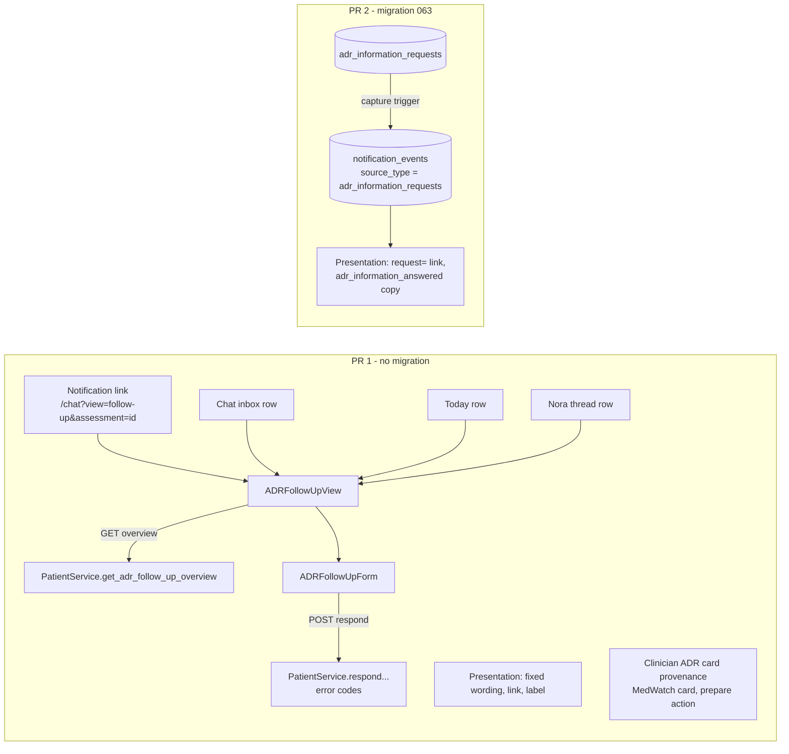

# Design Document: ADR information-loop gap fixes

> Base: `origin/main` `87a466d`. Requirements: [requirements.md](requirements.md) (approved 2026-10-12; D12 to D17
> decided 2026-10-12). Everything below was read in source at `87a466d`. For PR 3, the official Form 3500 PDF was
> inspected and a throwaway synthetic pypdf fill was run outside the repository; no repository code was executed.

## Overview

Two pull requests close gaps G1 to G10, and a third makes the MedWatch draft a real Form FDA 3500.

- **PR 1 (no migration):** a bilingual, token-built follow-up form hosted at `/chat?view=follow-up`, entry rows in
  the chat inbox and on Today, complete answered / closed / not-found states backed by one new bounded patient read
  endpoint, localized error classes, fixed bilingual notification wording, per-entry evidence provenance on the
  clinician ADR card, and the MedWatch draft defects.
- **PR 2 (migration 063, written, not applied):** each information request becomes its own notification source, so
  the patient's item follows the request's status. The legacy English notification stops, the clinician gets one
  History-only "patient answered" alert, answering marks the receipt read, and patient deletion cascades through
  ADR audit.
- **PR 3 (migration 064, written, not applied):** Form 3500 (not 3500A) data model, read-only preview, official
  fillable PDF download, discard, and a record of a submission the clinician made outside MediAgent. See
  [PR 3: MedWatch Form 3500](#pr-3-medwatch-form-3500).

Key decisions (PR 3 decisions K-P1 to K-P8 are in the PR 3 section):

| # | Decision | Reason |
| --- | --- | --- |
| K1 | Host the form in the chat page at `/chat?view=follow-up[&request=<id>\|&assessment=<id>]` | `/chat` is already in the exact-pathname allowlist (`notificationDestination()`); the chat page already owns the caution copy and thread-style back navigation. No allowlist change. |
| K2 | One new read endpoint, `GET /me/adr-information-requests/overview`, returning the selected request, pending requests and the bounded recent history | One round trip per view; the existing pending list keeps its contract for entry rows. |
| K3 | Stable error codes from the backend, mapped to four client classes | The form never shows server text (R3.7); "closed" switches state instead of retrying (R6.4). |
| K4 | PR 2 captures patient request events from `adr_information_requests` (new `source_type`), not from `adr_assessments` with a request ID in metadata | See [Choice of notification source](#choice-of-notification-source-requirement-97). |
| K5 | 063 redefines `review_adr_assessment` without the legacy `public.notifications` insert | Stops G7 going forward and leaves existing rows and events untouched (R10.2, R10.4). |
| K6 | Merge PR 2 before applying 063 | PR 2's backend works on both schemas; the PR 1 backend misroutes request-sourced links. See [Deploy order](#deploy-order). |

## Architecture

By PR.



| PR | Backend | Patient portal | Clinician portal | Docs / tracker |
| --- | --- | --- | --- | --- |
| 1 | `models/adr.py`, `services/patient_service.py`, `routers/patients.py`, `services/notification_centre_presentation.py` | `content/adr-follow-up-copy.ts`, `services/adr-follow-up.ts`, `hooks/use-pending-adr-follow-ups.ts`, `components/features/adr-follow-up-{form,view,entry-row}.tsx`, `app/(app)/chat/page.tsx`, `app/(app)/today/page.tsx`; `adr-follow-up-panel.tsx` removed and its tests migrated | `services/clinicians.ts`, `components/features/adr-review-card.tsx`, `medwatch-draft-card.tsx`, `medwatch-preparation-action.tsx`, `app/(dashboard)/medwatch/page.tsx`, shared review-time formatter | `.agent/TASKS.md`, `apps/patient-portal/README.md` |
| 2 | `db/migrations/063_adr_information_loop_lifecycle.sql`, presentation additions, tests | none | none | TASKS.md, NOT-001 spec |
| 3 | `db/migrations/064_medwatch_form_3500.sql`, `models/medwatch_form_3500.py`, `services/medwatch_service.py`, `services/medwatch_form_3500/{template,field_map,pdf,identifier,gate,upgrade,dates}.py`, `assets/fda/form-3500-2025-09.pdf` + `TEMPLATE.json` + `README.md`, `routers/clinicians.py`, `requirements.in` (`pypdf==6.20.1`) and both lockfiles | none | `services/clinicians.ts`, `components/features/form-3500-preview.tsx`, `medwatch-draft-card.tsx`, `medwatch-{download,submission,discard}-dialog.tsx`, `app/(dashboard)/medwatch/page.tsx`, print CSS | TASKS.md (PV-001-C, PV-002, schema row), NOT-003 (new clinician references), backend README |

## Components and Interfaces

PR 1 components below; PR 2 migration and presentation follow in their own sections.

### Patient read model and endpoint (R6, R4.1)

The router stays thin (`routers/patients.py`, `require_role("patient")`). Logic lives in `PatientService`, and
Pydantic models live in `models/adr.py`. `get_db` is the service-role client, so RLS does not apply. Every query
filters `patient_id = user.id`, which makes that filter the access control, so unit tests assert it.

```
GET /api/v1/patients/me/adr-information-requests/overview
    ?request_id=<uuid> | ?assessment_id=<uuid> | (neither)
-> ADRFollowUpOverviewRead
```

The route is declared before any `/{request_id}` path. Sending both parameters returns 422.

| Field | Content |
| --- | --- |
| `selected` | `request_id`: that request, any status. `assessment_id`: the newest request for that assessment. Neither: `null`. A missing or another patient's ID raises `NotFoundError`, giving the same 404 for both (R6.3). |
| `pending` | Every `pending` request, newest first. There is at most one per assessment (047 unique index). |
| `recent` | `answered` and `cancelled` requests created in the last 90 days, newest first, `limit(5)` (D5). |

`ADRFollowUpRequestRead` has `id`, `adr_assessment_id`, `status`, `symptom`, `suspect_medication_name`,
`requested_information` (allowlisted keys only), `patient_message`, `created_at`, `responded_at`, `closed_at` (the
row's `updated_at` when the status is `cancelled`), `responses` (the patient's own `{question, answer, evidence}`,
answered only) and `replacement_request_id` (the pending request on the same assessment when this one is cancelled).
It has no score or causality fields (R6.5). The existing `ADRInformationRequestRead` and its list endpoint are
unchanged; removing their score fields stays D11.

### Respond error mapping (R3.7, R6.3, R6.4)

- The load uses `.eq("id").eq("patient_id").limit(1)` instead of `.single()`. Zero rows raise `NotFoundError`, the
  same for a missing ID and for another patient's ID.
- When the request is not pending or the assessment is not draft, the service raises
  `ValidationError(code="ADR_REQUEST_CLOSED")`.
- The RPC call catches `postgrest.exceptions.APIError` (pattern: `care_conversation_service.py`): `P0002` becomes
  `NotFoundError`, `23514` becomes `ADR_REQUEST_CLOSED`, `22023` becomes `ValidationError(code="ADR_RESPONSE_INVALID")`,
  and anything else becomes `ExternalServiceError`. PostgREST details are never logged.

`classifyADRFollowUpError(error)` in `services/adr-follow-up.ts` reads `ApiClientError.status` and
`details.error.code`:

| Response | Class | Form behaviour |
| --- | --- | --- |
| 404 `NOT_FOUND` | `notFound` | Not-found state |
| 422 `ADR_REQUEST_CLOSED` | `closed` | Refetch the overview, then show the answered or closed state (no retry) |
| 502, 503, network or timeout | `unavailable` | Localized message and retry; answers kept |
| Anything else | `other` | Localized message and retry; answers kept |

### Patient copy module (R3.1, R3.2, R3.5, R3.6)

`content/adr-follow-up-copy.ts` follows `content/visits-copy.ts`. It defines a typed `ADRFollowUpCopy`, `EN` and `ES`
constants, `getADRFollowUpCopy(locale)` and `formatFollowUpDate(iso, locale, timeZone)` (Intl with the patient's
timezone). Key groups:

- Headings and safety: `eyebrow`, `heading(symptom)`, `reportedWith(med)`, `careTeamMessage`, `caution`.
- Questions and answers: `questions.<key>.{label, prompt, evidencePrompt}`, `answers.{yes, no, do_not_know}`.
- Review and send: `reviewAnswers`, `reviewHeading`, `confirm`, `send`, `sending`, `edit`, `unsentNote`, `sent`.
- States: `states.*` (loading, empty, error, not-found, answered with `answeredOn(date)`, closed, `openNewer`, `retry`).
- Errors: `errors.{closed, notFound, unavailable, other}`.
- Entry rows and history: `entry.{title, detail(count)}`, `recent.{toggle(count), answered, closed}`, `back`.

The en-US strings keep the existing selector text exactly: "Yes", "No", "I’m not sure", "Review answers", "Send to
care team" and "Edit" (R1.17). The es-MX strings use the "tu equipo de atención" register and go to the V13
reviewer. A parity test asserts a recursively equal key set, non-empty strings and non-empty function output in
both locales.

### Follow_Up_Form (R3, R1)

`components/features/adr-follow-up-form.tsx` exports `ADRFollowUpForm({ request, copy, locale, onSent, onClosed })`.
Its exemplars are `visit-offer-card.tsx` (row padding, labelled textarea, two-step compose / confirm / back) and
`notification-centre.tsx` (roles, `aria-busy`, `min-h-11`).

| Part | Build (tokens and primitives only) |
| --- | --- |
| Container | `rounded-[22px] bg-surface` with `px-[14px] py-[13px]` sections (GroupedList surface) |
| Eyebrow, title | `font-mono text-xs uppercase tracking-[0.08em] text-muted`; `h2 text-[17px] font-semibold text-ink break-words [overflow-wrap:anywhere]` |
| Care-team message | `rounded-xl bg-surface-2 p-3 text-sm text-ink-2 whitespace-pre-wrap break-words`, labelled `copy.careTeamMessage`, stored text verbatim (R3.4) |
| Caution | `rounded-2xl bg-note-tint px-3.5 py-2.5 text-[13px] text-note-ink` with `Icon name="info"` |
| Question | `fieldset` + `legend` (R3.8). Three options in `grid grid-cols-3 gap-2`. Each `label` is `ma-press flex min-h-11 items-center justify-center gap-1.5 rounded-2xl border px-2 py-2 text-center text-sm font-semibold break-words`, with `has-[:focus-visible]:ring-4 has-[:focus-visible]:ring-brand/25` (Tailwind 4) so focus on the `sr-only` radio is visible (R1.7). Selected: `border-brand bg-brand text-white` plus `Icon name="check"`. Unselected: `border-line-strong bg-surface text-ink-2`. |
| Evidence | Textarea with the exemplar classes, linked by `htmlFor`, `maxLength={500}`, and a `font-mono text-xs text-muted` counter in `aria-describedby` |
| Review | `divide-y divide-line` summary. The confirmation `label` is `flex min-h-11 w-full items-start gap-3 py-2` with the same focus ring; checkbox `h-5 w-5 accent-brand` (R1.5). |
| Error | `role="alert"`, `rounded-2xl bg-danger-tint p-3.5 text-sm text-danger-ink` (chat page pattern) |
| Actions | `Button` primary "Send" with `ProcessingDots` while sending, `Button` ghost "Edit", wrapped in `flex flex-wrap gap-2 [&_button]:min-h-11`; `copy.unsentNote` in `text-[13px] text-muted` above them (R6.8, D2) |

Validation, the 500-character limit, "I’m not sure" sending no description, the required confirmation and the
payload shape are unchanged (R3.9). There is no `AiChip` and no `ApprovalSeal` (R3.10).

### Host view, routes and entry rows (R4, R6)

`components/features/adr-follow-up-view.tsx` exports `ADRFollowUpView({ locale, requestId, assessmentId })`, which
loads the overview.

| State | Render |
| --- | --- |
| Profile or overview loading | Two `Skeleton` rects in a `role="status" aria-busy` wrapper with an sr-only label; no default-locale text (R3.3) |
| Load failed | `ErrorState` with `onRetry` and localized title and description |
| 404 | `EmptyState` (not found) with a "Back to messages" action |
| `selected` pending, or pending requests with no selection | One `ADRFollowUpForm` per pending request, selected request first |
| `selected` answered | Read-only summary of the patient's own answers and `answeredOn(date)`; no score (R6.1) |
| `selected` cancelled | Closed text; when `replacement_request_id` is set, `openNewer` links to `?view=follow-up&request=<id>` (R6.2) |
| Nothing pending, nothing selected | `EmptyState` |
| After a successful send | A persistent `role="status"` block (`rounded-2xl bg-brand-tint p-3.5 text-brand-ink`, `tabIndex={-1}`, focused through a ref) replaces the form, then the overview refetches (R6.7) |
| `recent` | A collapsed disclosure button (`aria-expanded`, the chat page's history-row pattern), at most 5 rows with a status `Badge` |

In `chat/page.tsx`, `searchParams.get("view") === "follow-up"` selects a follow-up mode. It renders the thread-style
header with a back button (`router.replace("/chat")`), the existing `controls.caution` strip (`bg-danger-tint
text-danger-ink`, R4.5) and `ADRFollowUpView`, and hides the Nora card, the inbox lists and the composer. The mode
sets `setConversationOpen(true)` as threads do, so the bottom navigation cannot overlap the actions. The page bottom
padding is `pb-[calc(env(safe-area-inset-bottom)+24px)]` (R1.11). A mounted view keeps the form's component state
when query parameters change (D2).

`ADRFollowUpEntryRow` is a `Link` to `/chat?view=follow-up` built like Today's "report a symptom" row
(`ma-press flex min-h-11 items-center gap-3 rounded-[22px] bg-surface px-[14px] py-[13px]`, `IconTile icon="note"
tone="note"`, chevron, count in `font-mono`). It is placed:

- in the chat inbox, after the Nora card;
- on Today, at the top of the content stack;
- in the open Nora thread, replacing `<ADRFollowUpPanel />` (R4.3).

The rows render only while `usePendingADRFollowUps()` (the existing pending list endpoint) reports one or more
requests (R4.4, R13.5). A load failure hides the row, because the destination view shows the error.
`redirectToLogin()` already keeps `pathname + search`, so a signed-out link returns to the form (R4.6; covered by a
test).

### Clinician evidence provenance (R7)

`provenance(entry)` returns `patient` for `source === "patient_follow_up"`, `ai` when `source` is absent and `other`
otherwise. The list-level `AiChip` is removed. Each entry shows exactly one label:

- `AiChip` "AI-extracted" for `ai`;
- a neutral `Badge` "Patient-confirmed" for `patient`, with the date in `font-mono` from the card's existing `en-US`
  formatter, shown only when `entry.information_request_id === item.informationRequestId` and `patientRespondedAt`
  is set;
- a neutral `Badge` "Other source" for `other`.

The React key is `${index}:${entry.question}:${entry.source ?? "ai"}`. `ADRReviewEvidence` gains
`source?: string | null` and `information_request_id?: string | null`. The caveat text and the footer stay.

### MedWatch (R8)

- **Card rebuild:** `fieldClass` (`components/ui/input.tsx`) for every input and textarea, labels in `text-ink-2`,
  fieldsets `border-line`. "Not submitted to FDA" becomes a `Badge variant="warning"`. Status `reviewed` shows an
  `ApprovalSeal` "Approved for export"; `draft` shows a `Badge variant="neutral"`. Errors use `role="alert"` with
  `risk-*` tokens; the approval panel uses `ok-soft` and `ok-line`. The draft ID uses `font-mono break-all`, and field
  paths and citations use `break-words [overflow-wrap:anywhere]` (R8.7).
- **Unsaved edits (R8.4):** the reset effect is replaced by a revision-keyed sync during render (the chat page's
  "adjust state when a prop changes" pattern). A new `draft.revision` or `formData` replaces the form only when the
  form equals the last synced baseline. Otherwise the edits stay, a warning `Badge` "Unsaved changes" shows, and Save
  still sends `expected_revision`, so a stale save surfaces the existing conflict error.
- **Prepare (R8.5):** `MedWatchPreparationAction.submit` catches, keeps the rationale and renders a local
  `role="alert"` beside the form. The page's `prepareDraft` stops setting the page-level error for this action, so the
  message appears once.
- **Formatting and loading (R8.6, R8.8):** the `en-US` formatter moves from `adr-review-card.tsx` into a shared module
  used by both cards. The `Suspense` fallback becomes the existing `LoadingQueue`.

### Presentation layer, PR 1 (R5, R4.2)

The fixed wording table matches requirements R5 exactly (`_QUESTION_WORDING: dict[str, tuple[str, str]]`).
`_questions(row, spanish)` keeps string values from the allowlist in first-seen order, removes duplicates, caps the
list at 3 and prefixes each entry with "• " under "Your care team asks about:" / "Tu equipo de atención pregunta
sobre:". With nothing left, it returns "".

| Event | en-US | es-MX |
| --- | --- | --- |
| `adr_information_requested` body | Answer a few questions in the app about a symptom you already reported. Describe only what already happened. | Responde en la app unas preguntas sobre un síntoma que ya reportaste. Describe solo lo que ya pasó. |
| Patient link | `/chat?view=follow-up&assessment=<source_id>` (`/chat?view=follow-up` when `source_id` is not a UUID) | same |
| Action label | Answer questions | Responder preguntas |

Titles are unchanged (R5.6). History items keep the link with the label "View" / "Ver".

## PR 2: migration 063 and presentation

### Choice of notification source (Requirement 9.7)

| Option | Actionability | G6 fix | Cost |
| --- | --- | --- | --- |
| A. Keep `adr_assessments` as source; add `information_request_id` to metadata | Lookup through metadata | 047 updates the assessment *before* inserting the request, so the trigger cannot see the new ID without reordering `review_adr_assessment`. Re-capture still needs a key or tuple change. | Smaller allowlist change, more coupling |
| **B. New source `adr_information_requests` (chosen)** | `source.status = 'pending'`: the request's own row | The patient event is captured on request INSERT only. Answer, rescore and `updated_at` touches no longer emit patient events (R9.1, R9.4). | Two CHECK extensions, the `notification_source` allowlist and one trigger |

B makes actionability follow the request directly. The 054 "newest receipt per source" rule then applies per request,
which covers supersede (R13.2). The answered alert has a natural source and an idempotent key. History is not
rewritten: old `adr_assessments`-sourced events stay, and only their computed actionability narrows (rule L below).
The source row also holds `responses` and `patient_message`. `notification_source` is internal and never returned by
the API (051 comment), and authorization only reads `patient_id`.

### 063 contents, in order (`063_adr_information_loop_lifecycle.sql`)

1. **Allowlists.** Drop and re-add `notification_events_event_type_check` with `adr_information_answered` added, and
   `notification_events_source_type_check` with `adr_information_requests` added. Both are supersets, so existing
   rows validate, and no UPDATE runs, so the append-only trigger is not involved.
2. **`private.notification_source`** (copy of 051): add `adr_information_requests` to the allowlist.
3. **`private.notification_actionable`** (copy of `059_critical_result_alerts.sql`, which carried 054 forward and added `critical_result`; that branch is kept). Only these branches change:
   - `adr_information_requested`, request-sourced: `s->>'status' = 'pending'`.
   - `adr_information_requested`, assessment-sourced (legacy, **rule L**): the 054 condition **and**
     `EXISTS(pending request r for e.source_id with r.created_at <= e.created_at)`. Answered gives no pending request,
     so History. A later request (before or after 063) has `created_at` later than the event, so History. Duplicates
     of a still-pending request remain one item through 054's newest-receipt rule.
   - `adr_information_answered`: `RETURN false` (D3).
4. **`private.capture_notification_source`** (copy of 055; no later redefinition):
   - The `adr_assessments` branch keeps `adr_review` and no longer emits `adr_information_requested`.
   - New `adr_information_requests` branch:
     - On INSERT with `status = 'pending'`: `adr_information_requested`, category `safety`, audience `patient`,
       metadata `{requested_information, clinician_id: requested_by, adr_assessment_id, information_request_id}`, key
       `adr_information_requests:<id>:requested`.
     - On UPDATE from `pending` to `answered`: `adr_information_answered`, category `safety`, audience `shared`,
       metadata `{adr_assessment_id, information_request_id}`, key `adr_information_requests:<id>:answered` (R11.1,
       R11.7).
     - Anything else returns NEW.
5. `CREATE TRIGGER notification_capture AFTER INSERT OR UPDATE ON public.adr_information_requests FOR EACH ROW
   EXECUTE FUNCTION private.capture_notification_source()`.
6. **`public.review_adr_assessment`** (copy of 047; 048 MedWatch did not redefine it): identical except that the
   `INSERT INTO public.notifications` block is removed (K5, R10.2).
7. **`public.respond_to_adr_information_request`** (copy of 047). After the request and assessment updates and the
   kept legacy `UPDATE public.notifications ... dedupe_key` (zero rows is fine, R10.5), it adds:
   - `PERFORM private.notification_prepare(p_patient_id, 'patient')`, so undelivered items become receipts;
   - `UPDATE notification_receipts SET read_at = coalesce(read_at, v_now)` for this patient's
     `adr_information_requested` receipts, either request-sourced (`source_id = p_request_id`) or legacy
     assessment-sourced (`source_id = adr_assessment_id`);
   - `INSERT INTO notification_read_audit(receipt_id, actor_id, action) ... 'read' ON CONFLICT DO NOTHING` (R9.3, D10).
   Capture and reads run in the source transaction, so a failure rolls back the answer (R11.9).
8. **Patient-deletion FK (R12):** `adr_assessment_audit_events_patient_actor_id_fkey` becomes `ON DELETE CASCADE`.
   `SET NULL` would break `exactly_one_actor`. This step ships only if the baseline reproduces G9 (R12.6).
   Clinician-side `RESTRICT`s are untouched (D1): `adr_information_requests.requested_by`,
   `adr_assessment_audit_events.actor_id`, `medwatch_drafts.created_by` / `approved_by` and
   `medwatch_draft_audit_events.actor_id`.
9. `REVOKE DELETE, TRUNCATE ON public.adr_assessment_audit_events, public.medwatch_draft_audit_events FROM PUBLIC,
   anon, authenticated, service_role` (R12.4).
10. **Grants:** `REVOKE ALL ... FROM PUBLIC, anon, authenticated` and `GRANT EXECUTE ... TO service_role` on both
    public RPCs, with signatures unchanged. Restate the 051 / 054 pattern for the three private functions:
    `capture_notification_source` is executable by nobody, the other two by `service_role`.
11. **Fail-closed `DO $$` block.** It raises if:
    - (a) a FK from `adr_information_requests`, `adr_assessment_audit_events`, `medwatch_drafts` or
      `medwatch_draft_audit_events` to `public.patients` or `public.adr_assessments` has `confdeltype NOT IN ('c',
      'n')` (only if step 8 ships);
    - (b) `anon`, `authenticated` or `service_role` has DELETE on either audit table;
    - (c) the `notification_capture` trigger is missing on `adr_information_requests`;
    - (d) `pg_get_functiondef('public.review_adr_assessment(uuid,uuid,text,text,jsonb)'::regprocedure)` contains
      `INSERT INTO public.notifications`;
    - (e) `anon` or `authenticated` can execute either RPC.

`private.email_preference` (057) and `public.create_medwatch_draft` (048) are not redefined: unmapped types return
NULL, meaning no email (R11.8), and the draft path already cancels pending requests.

### Presentation layer, PR 2 (R4.2, R11.2, R11.6)

- Patient `adr_information_requested` with `source_type = 'adr_information_requests'` links to
  `/chat?view=follow-up&request=<source_id>`. Assessment-sourced items keep the PR 1 link.
- `_COPY["adr_information_answered"]`: title "Patient answered medication-safety follow-up", body "A patient sent
  answers to follow-up questions. Review the updated evidence; this is not a clinical decision." The Spanish slots
  repeat the English, because the type is clinician-only. Category `safety`.
- `_safety_link` prefers `metadata.adr_assessment_id` when it is a valid UUID, else `source_id`: `/medwatch?assessment=<id>`,
  label "Review source".

## Data models

| Event (after 063) | `source_type` / `source_id` | Audience | Category | Key | Email |
| --- | --- | --- | --- | --- | --- |
| `adr_information_requested` | `adr_information_requests` / request | patient | safety | `adr_information_requests:<id>:requested` | `records` (057, unchanged) |
| `adr_information_answered` | `adr_information_requests` / request | shared (assigned clinicians, D7) | safety | `adr_information_requests:<id>:answered` | none |
| `adr_review` | `adr_assessments` / assessment | shared | safety | unchanged | unchanged |
| legacy `adr_information_requested` | `adr_assessments` / assessment | patient | safety | unchanged, history only | rule L gates eligibility |

**Request status x actionability (patient item)**

| Request status | How reached | Request-sourced item (063) | Legacy assessment-sourced item | Follow_Up_Form | Clinician alert |
| --- | --- | --- | --- | --- | --- |
| `pending` | `review_adr_assessment('request_information')` | Actionable; unread until read | Actionable only under rule L | Answer form | none |
| `answered` | `respond_to_adr_information_request` | History; receipt marked read | History | Read-only summary | One event, History, unread |
| `cancelled` (closed) | mark reviewed, dismiss, `create_medwatch_draft` | History; unread state unchanged (R13.3) | History | Closed, no answer needed | none |
| `cancelled` (superseded) | a new `request_information` on the same assessment | Old: History. New: actionable | History | Closed with a link to the newer request | none |

## Correctness Properties

*A property is a characteristic or behavior that should hold true across all valid executions of a system-essentially, a formal statement about what the system should do. Properties serve as the bridge between human-readable specifications and machine-verifiable correctness guarantees.*

Neither Hypothesis (`backend/requirements-dev.txt`) nor fast-check (either app's `package.json`) is a dependency,
and this work adds none. Each property is one table-driven test that enumerates a generated corpus exhaustively
(`itertools` in pytest, generated `it.each` tables in Vitest). The corpus is large enough to exceed 100 cases where
the domain allows. Each test carries the comment
`Feature: adr-loop-gap-fixes, Property <n>: <title>`.

### Property 1: Request wording is fixed, ordered and leak-free

*For any* value of `metadata.requested_information` and either locale, the item body's question lines SHALL equal a
reference model: the first-seen, de-duplicated allowed Question_Keys, capped at 3 and mapped to that locale's fixed
wording. Neither the title nor the body SHALL contain a raw Question_Key, a UUID or any input string outside the
fixed wording. The corpus covers every sequence of length 0 to 4 over {3 keys, padded key, free text, Spanish free
text, UUID, empty string, 201-character string, integer, `None`, object}, plus non-list values.

**Validates: Requirements 5.1, 5.2, 5.3, 10.3**

### Property 2: Notification links stay inside the allowlist

*For any* `adr_information_requested`, `adr_information_answered` or `adr_review` row with arbitrary `source_id`,
`source_type` and metadata, the patient link SHALL be `/chat?view=follow-up` with at most one `request` or
`assessment` parameter holding a canonical UUID, and SHALL pass `notificationDestination()`. The clinician link SHALL
be `null` or `/medwatch?assessment=<canonical UUID>`.

**Validates: Requirements 4.2, 11.2**

### Property 3: Copy parity across locales

*For any* key path in the en-US follow-up copy, the es-MX copy SHALL define the same path with a non-empty string, or
a function returning a non-empty string for sample arguments, and the reverse.

**Validates: Requirements 3.1, 3.2, 1.18**

### Property 4: Error classification is total and never shows server text

*For any* thrown value (an `ApiClientError` with status 0 to 599 and any `error.code` from the known set or arbitrary
text, a plain `Error`, or a non-error), `classifyADRFollowUpError` SHALL return exactly one of `closed`, `notFound`,
`unavailable` or `other`. The message rendered for it SHALL be the Saved_Locale copy for that class and SHALL never
contain the server message.

**Validates: Requirements 3.7, 6.3, 6.4**

### Property 5: Review is enabled exactly for complete answers, with an unchanged payload

*For any* request with 1 to 3 Question_Keys and any assignment of answer (none, `yes`, `no`, `do_not_know`) and
evidence (empty, whitespace, 1 to 500 characters) per question, "Review answers" SHALL be enabled exactly when every
question has an answer and every `yes` / `no` has non-blank evidence. The submitted payload SHALL equal
`{answers: [{question, answer, evidence?}], confirmed: true}`, with no evidence for `do_not_know`.

**Validates: Requirements 3.9**

### Property 6: Each evidence entry carries exactly one truthful provenance label

*For any* evidence list, including repeated questions and arbitrary `source` values, the card SHALL render one entry
per input element. Each entry SHALL carry exactly one label (`AI-extracted` iff `source` is absent,
`Patient-confirmed` iff `source === "patient_follow_up"`, `Other source` otherwise). The number of `AiChip`s SHALL
equal the number of AI entries, no `ApprovalSeal` SHALL render, and React SHALL report no duplicate-key warning.

**Validates: Requirements 7.1, 7.2, 7.4, 1.15**

### Property 7: At most one actionable patient request item, and it belongs to the pending request

*For any* enumerated sequence of up to three operations on one assessment (request, answer, re-request, mark
reviewed, dismiss, prepare MedWatch draft, touch `updated_at`), after each step the patient SHALL have at most one
actionable `adr_information_requested` item. That item SHALL exist exactly when a request is pending and SHALL be
that request's. This runs in the disposable PostgreSQL test over a fixed enumerated set (about 12 sequences)
instead of 100 random runs, because every case costs a database round trip.

**Validates: Requirements 9.2, 10.1, 13.1, 13.2**

## Error handling

| Failure | Where | Behaviour |
| --- | --- | --- |
| Request missing or another patient's | Overview and respond | `NotFoundError`, a 404 with the same body for both; localized not-found state |
| Request no longer pending, or assessment not draft | Service check or RPC `23514` | 422 `ADR_REQUEST_CLOSED`; the form refetches and shows answered or closed |
| Invalid payload | Pydantic or RPC `22023` | 422; `other` class; answers kept |
| Database or transport failure | `execute_async`, other `APIError` | 502 `EXTERNAL_SERVICE_ERROR` with no PostgREST detail; `unavailable` class; retry |
| Both `request_id` and `assessment_id` | Overview | 422 |
| Overview load fails | View | `ErrorState` with retry; entry rows hide silently |
| Capture or read-audit failure inside respond (063) | PostgreSQL | The whole answer rolls back (same transaction); client sees `unavailable` |
| MedWatch prepare fails | Preparation action | Inline `role="alert"`; rationale kept; no unhandled rejection |
| MedWatch refresh during edits | Draft card | Edits kept; "Unsaved changes"; a stale save returns the existing revision conflict |
| Unknown `event_type` on an older backend | Presentation | Falls back to the generic "Update available" copy (`event_type` is `str`), so nothing crashes |

## Testing strategy

**Unit and component tests (both PRs).**

- Backend:
  - `test_notification_centre_presentation.py`: migrate the "shown as written" and old-link assertions (R5.7); add P1
    and P2 and the `adr_information_answered` copy.
  - `test_patient_service.py`: overview filters (`patient_id` on every query, statuses, 90-day bound, `limit(5)`,
    ordering), same 404 for missing and foreign, error-code mapping.
  - `test_patient_api.py`: route, 422 for both parameters, response excludes scores.
- Patient portal:
  - copy parity (P3), classifier (P4), form (P5);
  - migrated `adr-follow-up-panel` tests, now on the form and view;
  - view states;
  - chat page `view=follow-up`, the Nora-thread row, and inbox and Today rows (0, 1 or 2 pending);
  - storage spies (R6.8), the `redirectToLogin` return path, and `notificationDestination` for the new links.
- Clinician portal:
  - a new `adr-review-card.test.tsx` (P6; all-AI, all-patient and mixed);
  - MedWatch card unsaved-edit and seal tests, the prepare inline error, the formatter, and the `Suspense` fallback.
- Migration text tests (PR 2): `tests/unit/db/test_adr_loop_gap_fixes_migration.py` asserts each item of the 063
  order list at text level (pattern: `test_adr_patient_information_loop_migration.py`).

**PostgreSQL contract tests (PR 2), reproduction first.**

The base `sql` fixture in `test_notification_centre_postgres.py` is extended:

- add `042_auditable_adr_assessments.sql` before 046;
- add `047_adr_patient_information_loop.sql`, `047_care_plan_private_rls_helpers.sql`,
  `048_care_team_conversations.sql` and `048_medwatch_draft_lifecycle.sql` in ledger order;
- move the 057, auth-revoke and 058 steps from `email_sql` into it (`email_sql` then returns `sql`);
- apply 063 last unless `ADR_LOOP_GAP_BASELINE=1`.

The existing notification and email suites therefore also prove that 063 regresses nothing (R14.3). New tests live in
`tests/integration/test_adr_loop_postgres.py`. **The baseline run (`ADR_LOOP_GAP_BASELINE=1`) comes first, before 063
exists, and its outcome is recorded in the PR.**

| NEEDS REPRO | Test | Expected baseline (main behaviour) | After 063 |
| --- | --- | --- | --- |
| R9.1 | `test_answer_creates_no_new_patient_request_event` | Fails: a second `adr_information_requested` event appears | Passes |
| R9.2 | `test_answered_request_item_is_history` | Fails: the re-captured item is actionable and unread | Passes |
| R10.1 | `test_one_patient_item_per_request` | Fails: `legacy_update` plus the request item give 2 | Passes |
| R12.1, R12.2 | `test_patient_deletion_after_answer_with_medwatch_draft` | Expected to fail with an FK violation on `patient_actor_id`; the test decides | Passes. If the baseline passes, no FK change ships (R12.6) and the test stays |
| R13.2 | `test_superseded_request_is_history` | Likely passes (054 newest-receipt rule); recorded either way | Passes; kept as a guard |

Also covered (not NEEDS REPRO):

- R9.3 to R9.7: read receipt, assessment touch, no repeated `email_outbox` row, history unchanged, request ID in the
  event;
- R10.2, R10.4, R10.5;
- R11.1, R11.3, R11.4, R11.5, R11.7, R11.8, R11.9: one alert, routing, a revoked assignment, a patient denied, not in
  `action_items`, idempotent retry, no email, rollback when capture fails (pattern:
  `test_source_capture_failure_rolls_back_source`);
- R12.3 to R12.5: another patient untouched, no DELETE privilege, clinician deletion still blocked;
- R13.1, R13.3, R13.4;
- P7.

`test_adr_reviewed_questions_only_and_current_status` moves to the `dose_response` key (R14.7).

**Commands** are V1 to V11 in requirements.md. The backend venv and the apps' `node_modules` must be created first
(see the Verification plan set-up).

## Deploy order

Merging deploys the backend; migrations apply only with explicit authorization (V14).

1. **PR 1** needs no migration. The overview reads 047 tables and columns, which are applied in staging. Before 063 the
   patient may still see G6's re-captured item, but its link opens the overview by assessment, which shows the
   answered state, so PR 1 already turns the visible defect into a correct screen.
2. **PR 2 backend before 063 is safe.** The presentation handles both source types. `adr_information_answered` copy
   and the metadata-preferring `_safety_link` are unused until 063 emits them. The respond RPC signature is unchanged,
   and no backend code depends on 063 objects. No gate is needed.
3. **063 before the PR 2 backend is degraded, not broken.** A PR 1 backend would link request-sourced items to
   `assessment=<request id>`, producing the not-found state, and would render the answered alert with the generic
   copy and a `/medwatch` link that shows "no longer awaiting review".
4. **Recommendation:** merge PR 1, merge PR 2 (backend deploys), then apply 063 on the requester's explicit
   authorization. PR 2's description states this (R14.5).

## PR 3: MedWatch Form 3500

Requirements 15 to 24. MediAgent prepares, previews and downloads Form FDA 3500 (09/2025). The clinician submits it;
no code path transmits anything to FDA (R22.3). Template facts below come from the inspected official PDF (V23 still
confirms the copyright notice).

### PR 3 decisions

| # | Decision | Reason |
| --- | --- | --- |
| K-P1 | Discard is three columns on `medwatch_drafts` (`discarded_at`, `discarded_by` RESTRICT, `discard_reason`), not an enum value. `idx_medwatch_one_draft_per_assessment` becomes a partial unique index `WHERE discarded_at IS NULL`. | `ALTER TYPE ... ADD VALUE` cannot be used in the transaction that adds it (R23.7); columns also keep the approval state a discarded draft had. |
| K-P2 | New append-only table `medwatch_external_submissions`; the newest row per draft is current; amendments are new rows (D17). The record RPC sets `status = 'submitted'` and `submitted_at`; a trigger allows `submitted` only with approval and a submission row. | History is never rewritten. A CHECK cannot see another table, so the cross-table rule is a trigger (R22.6). |
| K-P3 | Audit types gain `discarded`, `submission_recorded`, `submission_amended`. `exported` gains `format` and, for PDF, `template_revision`, `template_sha256`, via `record_medwatch_draft_export(uuid, uuid, text, text, text)`; the 2-argument function delegates with `'json'`. | One audit trail per draft (R21.6); old callers keep working during rollout. |
| K-P4 | The PR 3 backend requires 064 before merge (the EMAIL-001 / 058 pattern). | New routes call 064 RPCs; 048 routes are unchanged. See [PR 3 deploy](#pr-3-deploy). |
| K-P5 | pypdf 6.20.1 fills a vendored, checksummed template; AcroForm and XFA `datasets` both written; re-encrypted with the template's own permissions; not flattened. | Pure Python, BSD; PyMuPDF is AGPL (R21.8). The fill test showed viewers disagree when only one layer is written. |
| K-P6 | `MedWatchFormData` v2 (`form_version: "fda-3500-2025-09"`) with a separate `mediagent_review`; `upgrade_legacy_form` runs on read. | Backward compatible with 048 rows without a data migration (R16.5). |
| K-P7 | Default A1 code `<first initial><last initial>-<4 chars>`, the 4 chars from base32 SHA-256 of the draft ID; no new secret; stored on the draft. | Non-reversible to patient data and stable for the draft's life (D16, R17.2). |
| K-P8 | B6 is never prefilled in PR 3. | See [B6 conclusion](#b6-conclusion-r187). |

### Template asset (R15)

`backend/src/app/assets/fda/` holds `form-3500-2025-09.pdf` (the byte-identical official download, 921,232 bytes),
`README.md` (provenance, "US government work; no copyright claimed" once V23 confirms it, re-pin steps) and
`TEMPLATE.json`: title "FORM FDA 3500", revision "09/2025", OMB "0910-0291", expiry "2027-09-30", 8 pages, 239 fields
(142 text, 83 checkbox, 14 choice), `field_inventory_sha256` of the sorted names, `choice_options`, `encrypt_p`
-1084, source URL `https://www.fda.gov/media/76299/download`, download date and SHA-256
`1147d7c86bb002cba7fb9352ca8e3402524d8fa0236916b7bf7e5dcdcf88bf9c`. `template.py` loads it via `importlib.resources`
once per process (no network, R15.2) and checks the SHA-256, page and field counts, inventory hash and every
`FIELD_MAP` name. A mismatch raises `TemplateMismatchError`: 503 `FORM_3500_TEMPLATE_MISMATCH`, no `exported` event
(R15.4). The template is AES-256 (V5/R6), empty user password, `P = -1084` (fill and print allowed).

### Data model v2 (R16)

`models/medwatch_form_3500.py`. Dates are `FdaDate`: ISO `YYYY-MM-DD` or `YYYY-MM` (month and year, FDA B3). Enumerated
values are `Literal`s whose PDF values come from `TEMPLATE.json`, so a value outside the option list fails with 422
naming the path (R16.3).

```python
class MedWatchFormDataV2(BaseModel):
    form_version: Literal["fda-3500-2025-09"]
    section_a: SectionA  # identifier, age_value/unit, date_of_birth, sex F|M, weight_value/unit kg|lb, race (6), hispanic_latino
    section_b: SectionB  # report_types (4), outcomes (7), death_date, event_date + event_date_confirmed, report_date,
                         # narrative, tests: list[TestRow] <= 8, tests_comments, other_history
    section_d: SectionD  # product_1: Product, product_2: Product | None (name, strength/unit, manufacturer_compounder,
                         # ndc_or_unique_id, lot, dose/unit, frequency(+other), route(+other), therapy start/stop/reduced,
                         # duration/unit, ongoing, diagnosis_for_use, product_types, expiration_date, abated, reappeared)
    section_f: SectionF  # others: list[OtherProduct] <= 10 (name, start, end)
    section_g: SectionG  # names, address, city, state, zip, country, phone, email, health_professional, occupation,
                         # also_reported_to (4), identity_withheld
    mediagent_review: MediAgentReview  # naranjo_score, causality, reportability_rationale; never written to the PDF
    legacy: dict[str, str] = {}        # 048 text with no Form 3500 home; read-only, shown in the preview
```

Validators (R16.4): dates must be real; `event_date`, `report_date`, `death_date`, therapy dates are not after the
save date (America/Los_Angeles); `therapy_stop >= therapy_start`; `expiration_date` may be future. `frequency_other`
and `route_other` are required exactly when `Other` is chosen. Purchase-place, product-address and Section C / E
fields are not modelled; they stay blank for the clinician to complete in the PDF (R16.2, D13).

`upgrade_legacy_form(data, *, draft_id, patient) -> dict` is pure and idempotent (v2 input is returned unchanged).
The 048 row is untouched until the next save writes v2 (R16.5):

| 048 path | v2 target | Rule |
| --- | --- | --- |
| `patient.patient_identifier` | `section_a.identifier` | Replaced by the default code (K-P7) if it fails R17.3; the name is dropped, not kept |
| `patient.date_of_birth`, `sex`; `event.onset_date_or_time` | A DOB, sex; B3 (unconfirmed) | Parsed date; `female`/`f` -> F, `male`/`m` -> M; otherwise `legacy` |
| `event.description`; `event.outcome`, `seriousness` | B5; `legacy` | Verbatim; free text cannot pick B2 boxes safely |
| `suspect_product.*` | `section_d.product_1.*` | `name`, dates direct; `frequency` / `route` matched case-insensitively to an option, else `Other` + `*_other`; `dose` split only when it matches `<number> <unit abbreviation>`, else `legacy` |
| `concomitant_products.products` | `section_f.others[].name` | Split on comma, semicolon or newline; if more than 10 items, the whole string goes to `legacy` |
| `tests_and_history.*`; `clinical_review.*` | B6 comments, B7; `mediagent_review` | Verbatim |
| `reporter.*` | G names (exactly two tokens), email; `specialty`, `clinic_name` to `legacy` | Otherwise `legacy` |

### B6 conclusion (R18.7)

No migration creates a lab-result table. `clinical_facts` (017) holds approved facts, and FHIR imports store
Observations as `fact_type = 'observation'` (`code`, `value`, `effective`, `reference_range`) without the Observation
`category` (`fhir_import_service.py`), so a lab result cannot be told from a vital sign. The R18.7 WHERE condition is
never met in PR 3: B6 rows stay blank and editable ("Not provided"). Storing the category is out-of-scope follow-up.

### Prefill and identifier (R17, R18)

`_build_form_data` becomes `build_form_3500(sources) -> (form, source_evidence)`, one evidence entry per filled path
(R18.1); sources are in the field map, and assessment evidence keeps its own `source` (R18.6). B3 comes from `onset`
when it parses, else the `created_at` date, unconfirmed and labelled "Best estimate, confirm" (R18.4). B4 defaults to
the approval date (America/Los_Angeles) when blank. G health professional and occupation stay blank (R18.3).

`identifier.py`:

- `default_code(first, last, draft_id)`: NFKD accent-stripped, upper-cased initials (`X` if missing) plus the first 4
  characters of `base32(sha256(draft_id.bytes))`, or the next window if that fails `identifier_violations`. The
  service generates the draft UUID and passes it to the 064 `create_medwatch_draft` overload, which stores
  `patient_reference` (CHECK `^[A-Z]{2}-[A-Z2-7]{4}$`) and the same A1 value in one insert.
- `identifier_violations(value, patient)`: casefolded, accent-stripped, tokenised on non-alphanumerics; rejects the
  full name, a first or last name token, the email or its local part, and the DOB as ISO, `MM/DD/YYYY`, `DD-Mon-YYYY`
  or digits (R17.3). `name_warnings` applies the same matcher to B5, B6, B7 and F text against patient, assigned
  clinician and clinic names and returns `{path, kind}` (R17.4).

### Approval gate (R19)

`gate.py: approval_issues(form, ctx) -> list[GateIssue(path, code)]`, a pure function used by the draft read model
(`missing_for_approval`), the preview and `approve_draft`, with one code per R19.1 item plus `identifier_identifies`
(R17.3), `death_date_missing` (R19.2) and `non_serious_attestation_required` (D12).

`MedWatchDraftApprovalRequest` gains `attestation_version: Literal["medwatch-3500-approval-v1"]`,
`non_serious_attested` and `acknowledged_warnings`. The service loads the stored row, returns the existing revision
conflict on a stale `expected_revision`, runs the gate on the stored form (R19.4) and returns 422
`MEDWATCH_APPROVAL_INCOMPLETE` with the issues unless none remain. The D12 issue clears only when no B2 outcome is set
and `non_serious_attested` is true; acknowledged warnings must equal the current set. 064's
`approve_medwatch_draft(uuid, uuid, text, integer, jsonb)` writes these three values into the `approved` event (R17.5,
R19.3, R19.6). The attestation text is one backend constant returned with the draft, so the UI shows that version.

### Field map (R21.2, R21.3)

`field_map.py` holds one explicit entry per field: AcroForm name (prefix `topmostSubform[0].`, `[0]` dropped below),
XFA `datasets` path (under `xfa:data/topmostSubform`), model path, kind. XFA paths are explicit because they do not
follow AcroForm names: `Prod1Name`, `Prod1Dose`, `Prod1Diagnosis`, `Prod1Address` (and `Prod2*`) sit at the data root;
`ZipCode`, `CharCounter` and `Cell4` repeat; F row 1 has a `Prod1` element.

| Item | AcroForm | XFA | Model | Source | Req. |
| --- | --- | --- | --- | --- | --- |
| A1 | `Page1.SecA_Patient.PatientIdentifier` | `SecA_Patient/PatientIdentifier` | `section_a.identifier` | K-P7 | yes |
| A2 age | `…AgeValue`, `Age{Years,Months,Weeks,Days}` | `SecA_Patient/…` | `age_value`, `age_unit` | none | |
| A2 DOB | `…DateBirth` | `SecA_Patient/DateBirth` | `date_of_birth` | patients | |
| A3 sex | `…SexF`, `…SexM` | `SecA_Patient/Sex{F,M}` | `sex` | patients.gender | |
| A4 weight | `…WeightValue`, `WeightKG`, `WeightLB` | `SecA_Patient/…` | `weight_*` | none | |
| A5 race, ethnicity | `…Race{AmInd,Asian,Black,MiddleEastern,Pacific,White}`, `…EthnicLatino` | `SecA_Patient/…` | `race`, `hispanic_latino` | none | |
| B1 | `…Rep{Adverse,Error}`, `…Defects`, `…DiffManu` | `SecA_Patient/…` | `section_b.report_types` | assessment | yes |
| B2 | `…Death`, `DeathDate`, `LifeThreaten`, `Hospital`, `Disability`, `Congenital`, `ReqdInter`, `OtherEvents` | `SecA_Patient/…` (not `Advice/AdverseEventsList/*`) | `outcomes`, `death_date` | clinician | D12 |
| B3, B4 | `…EventDate`, `…ReportDate` | `SecA_Patient/…` | `event_date`, `report_date` | symptom report; approval date | B3 yes |
| B5 | `Page2.SecB_Adverse.DescEvent` | `Page2/SecB_Adverse/DescEvent` | `narrative` | symptom_reports | yes |
| B6 rows | `Page3.TestDataTable.RowN.{TestDataN,TLowRangeN,THighRangeN}`; dates `Row1.TDate1`, `Row2.TDate2`, `Row8.TDate3`…`TDate8`; `THighRange7` is in `Row8` | `TestDataTable/RowN/…` (same irregular nesting) | `tests[n-1]` | none (K-P8) | |
| B6 comments | `Page3.AdditionalComments` | `AdditionalComments` | `tests_comments` | 048 `relevant_tests` | |
| B7 | `Page3.Sec6Data.OtherHistory` | `Sec6Data/OtherHistory` | `other_history` | conditions, allergies | |
| D name, dose, use | `Page4.Prod1.Prod1Name`, `Prod1Dose`, `Prod1Diagnosis` | `Prod1Name`, `Prod1Dose`, `Prod1Diagnosis` (root) | `product_1.*` | medications | name yes |
| D strength, units, freq, route | `…Prod1Strength`, `Prod1StrengthUnit`, `Prod1DoseUnit`, `Prod1Freq`, `Prod1FreqOther`, `Prod1Route`, `Prod1RouteOther` | `Prod1/…` | `product_1.*` | medications | |
| D IDs | `…Prod1ManuComp`, `Prod1NDC_ID`, `Prod1LotNum`, `Prod1ExpDate` | `Prod1/…` | `product_1.*` | medication document | |
| D therapy | `…Prod1Therapy{StartDate,StopDate,ReduceDate,Duration,DurUnit,OngoingYes,OngoingNo}` | `Prod1/…` | `product_1.therapy_*`, `ongoing` | medications | |
| D type | `…Prod1{Brand,Generic,OTC,Compounded,PdtOther,Cannabi,CosRetail,CosmProf}` | `Prod1/…` | `product_types` | none | |
| D abated, reappeared | `…Prod1Abated{Yes,No,NA}`, `…Prod1Reappear{Yes,No,NA}` | `Prod1/…` | `abated`, `reappeared` | Naranjo answers (R18.5) | |
| D product 2 | `Page5.Prod2.Prod2*` (note `pdt2CosmProf`, `Pdt2Cannabi`, `Pdt2CosRetail`, `Pdt2PdtOther`) | `Prod2/…`; `Prod2Name`, `Prod2Dose`, `Prod2Diagnosis` at root | `product_2.*` | clinician | |
| F rows 1 to 10 | `Page6.SecF_Other.Table1.RowN.{ProdN,StartN}`; end `Row1.End1`, `Row2.End2`, `Row3`…`Row10.Cell4` | `SecF_Other/Table1/RowN/…` | `others[n-1]` | other active medications | |
| G name, contact | `Page7.SecG_Reporter.{FirstName,LastName,Address,City,State,ZipCode,Country,PhoneNum,Email}` | `SecG_Reporter/…` | `section_g.*` | clinicians (name, email) | name, phone or email |
| G professional, occupation | `…ProYes`, `…ProNo`, `…Occupation` | `SecG_Reporter/…` | `health_professional`, `occupation` | clinician | yes |
| G also reported, identity | `…ManuComp`, `UserFac`, `DistImp`, `Packer`, `IdentityNo` | `SecG_Reporter/…` | `also_reported_to`, `identity_withheld` | clinician | |
| Header, C, E, Advice | `Page1.Header.*`, `Page3.TestDataTable.{EvalYes,EvalNo,EvalRetd,ReturnDate}`, `Row7.PicYes`, `Page6.SecE_Device.*`, `Page7.Advice.*`, `ResetForm` | n/a | none | blank (R16.2, R20.3) | |

Template quirks pinned by tests: the `WeightKG` / `WeightLB` tooltips are swapped, so the map follows the printed
labels and V22 checks them; choice fields store an export value that can differ from the display text (duration units
`5` = "Day(s)"; strength and dose units use numeric export values, and the second option's pair is inconsistent), so
the model stores the display text and the map writes the paired export value from `TEMPLATE.json`, excluding any pair
the read-back test cannot round-trip.

### PDF fill (R21)

`pdf.py: render_form_3500(form, draft_id) -> bytes`:

1. `map_form(form)` returns AcroForm-name and XFA-path dicts. Dates use `dates.fda_date` (`03-Oct-2026`, or `Oct-2026`
   for month and year, from a fixed English tuple, not `strftime`); checkboxes `/1` / `/Off` (XFA `1` / `0`); choices
   only from the option list.
2. `PdfReader(template).decrypt("")`, `PdfWriter(clone_from=reader)`, `update_page_form_field_values(page, values,
   auto_regenerate=False)` per page, `/NeedAppearances true`.
3. Parse the XFA `datasets` stream with `xml.etree.ElementTree` (trusted, checksum-pinned input), require exactly one
   element per path, set `.text` (the serializer escapes) and write the stream back.
4. Metadata only (D14): `/Subject` appends "Draft prepared in MediAgent; not submitted to FDA by MediAgent" to the
   original subject; `/Keywords` "fda-3500; not-submitted". No official field, page or XMP change.
5. `encrypt(user_password="", owner_password=secrets.token_urlsafe(32), permissions_flag=TEMPLATE.encrypt_p,
   algorithm="AES-256")`; the owner password is never logged or stored. Not flattened (D13).

`GET .../{id}/export.pdf` requires `reviewed` with `approved_at`, or `submitted`, and not discarded (else 422). An
approved 048-shape draft failing the gate gets 422 `MEDWATCH_LEGACY_DRAFT_INCOMPLETE` ("discard and prepare a new
draft", R16.6). It renders, calls `record_medwatch_draft_export(id, actor, 'pdf', '09/2025', sha256)`, and only after
that commits returns the bytes as `application/pdf` with `Content-Disposition: attachment;
filename="fda-3500-<first 8 of draft id>-not-submitted.pdf"` and `Cache-Control: no-store`. The JSON export keeps its
route, uses `artifact_type: "fda_3500_draft"` plus `form_version`, and records `'json'` (R15.1, R21.9).

### Routes (R20 to R24)

All under the existing `/api/v1/clinicians/me/medwatch-drafts` prefix, thin, `require_role("clinician")`:

| Route | Behaviour |
| --- | --- |
| `GET ?state=active\|submitted\|discarded` (default `active`) | active: `draft`/`reviewed`, not discarded; submitted: `submitted`; discarded: `discarded_at` set. Each item has `missing_for_approval`, `name_warnings`, `current_submission` |
| `GET /{id}/preview` | `Form3500Preview`: sections A to G in form order with item numbers and labels from `field_map.py`, display value or `null`, provenance list, `missing_for_approval`; C and E as `not_completed_by_mediagent`; `mediagent_review`; `template {revision, expires, may_be_superseded}` (R15.5) |
| `GET /{id}/export.pdf`, `GET /{id}/export` | As above |
| `POST /{id}/discard` `{reason, expected_revision}` | Allowed for `draft`, or `reviewed` with no submission (D15); 422 when submitted (R23.5) |
| `POST /{id}/submission` `{submitted_on, method, method_detail?, fda_reference?, attested: true, expected_revision}` | Allowed for `reviewed`, not discarded, no submission (R22.1, R22.2) |
| `POST /{id}/submission/amend` `{amends_id, submitted_on, method, method_detail?, fda_reference?, reason}` | `amends_id` must be the current record (else 409) (R22.7) |

`_get_authorized_draft` and `_get_assessment` use `.limit(1)`: zero rows raise `NotFoundError` (404), an unassigned
clinician still gets `AuthorizationError` (403) (R24.1). RPC errors map as in PR 1: `P0002` 404, `42501` 403, `23514`
422 or 409 for revision conflicts, `22023` 422, anything else 502 with no PostgREST detail. `PUT` rejects edits to
submitted or discarded drafts (R22.5).

### Migration 064 (`064_medwatch_form_3500.sql`, requires 063)

1. `medwatch_drafts`: add the K-P1 columns (`discard_reason` 1 to 2000 characters, all three null or all set, never
   with `submitted`) and `patient_reference`. Default `export_version` to `'fda-3500-2025-09'`, relabel
   `'medwatch-3500a-draft-v1'` rows `'fda-3500-legacy-048'`, fix the 001 `form_data` comment (R15.1); audit rows stay.
2. Recreate `idx_medwatch_one_draft_per_assessment` as a partial unique index `WHERE discarded_at IS NULL` (R23.4).
3. `medwatch_external_submissions` (K-P2) with CHECKs `attested`, `method_detail` required for `other`,
   `(amends_id IS NULL) = (amend_reason IS NULL)`; index `(medwatch_draft_id, created_at DESC)`; RLS select for
   actively assigned clinicians (048 pattern); `REVOKE ALL` from every role, then `GRANT SELECT` to `authenticated`
   and `service_role`. A `BEFORE UPDATE` trigger raises; DELETE is blocked by privilege, not a trigger, so the
   patient cascade still works (R12, R24.2).
4. Replace `medwatch_drafts_not_submitted_by_app` with CHECK `(status = 'submitted') = (submitted_at IS NOT NULL)`
   and trigger `medwatch_drafts_submission_guard` (`BEFORE INSERT OR UPDATE`): `submitted` needs approval and a
   submission row; a submitted or discarded row rejects changes to `form_data`, `status`, `revision` and the discard
   columns (R22.5, R22.6).
5. Extend the MedWatch audit types (K-P3) and the ADR audit types with `medwatch_draft_discarded`.
6. RPCs (SECURITY DEFINER, `search_path = public`, active-assignment check, `FOR UPDATE`, `expected_revision`):
   `create_medwatch_draft(uuid, uuid, jsonb, jsonb, text, uuid)` (caller-supplied ID and `patient_reference`),
   `approve_medwatch_draft(uuid, uuid, text, integer, jsonb)`, the 5-argument export (allows `reviewed` or
   `submitted`, rejects discarded; the 2-argument one delegates), `discard_medwatch_draft(uuid, uuid, text, integer)`,
   `record_medwatch_external_submission` and `amend_medwatch_external_submission` (date not after today and not
   before approval, America/Los_Angeles).
7. Discard, in one transaction: set the discard columns, bump `revision`, return the assessment to `draft` with
   `last_review_action`, `reviewed_by`, `reviewed_at` NULL (046 allows a NULL action; the contract test confirms no
   other CHECK objects), and insert ADR audit `medwatch_draft_discarded` and MedWatch audit `discarded`
   `{reason, previous_status, revision}`. Requests cancelled at draft creation stay cancelled.
8. Grants: every new or changed RPC `REVOKE ALL ... FROM PUBLIC, anon, authenticated`, `GRANT EXECUTE ... TO
   service_role`; `REVOKE DELETE, TRUNCATE` on both audit tables and the submission table from all three roles.
9. Fail-closed `DO $$` block raising if the partial index or guard trigger is missing, `anon` or `authenticated` can
   execute a MedWatch RPC, any role holds UPDATE, DELETE or TRUNCATE on the submission table, a new patient FK is not
   `CASCADE`, or the 2-argument export does not call the 5-argument one.

**Discard notifications (R23.6).** After 063, the `adr_assessments` capture branch emits only `adr_review`, on a
change to `draft` from another status, and 054 makes `adr_review` actionable while the live status is `draft`. The
clinician therefore gets one actionable item: a new event, or the original becoming actionable again if 055's
idempotency key de-duplicates; the contract test pins which. No patient item becomes actionable: request-sourced items
need a pending request, and rule L needs one too. No email, because 057 maps no category for `adr_review`.

### Clinician UI (R20 to R23, Requirement 1)

Exemplars: the 8.1 `medwatch-draft-card.tsx` (`fieldClass`, `Badge`, `ApprovalSeal`, `role="alert"`, unsaved-edits
sync), `adr-review-card.tsx` (per-entry provenance) and `components/ui/modal.tsx`; tokens and primitives only (R1).

- **`form-3500-preview.tsx`**, no inputs (R20.7): one `section` per Form 3500 section with an `h3`, a `dl` of
  `font-mono` item number, label, value (`break-words [overflow-wrap:anywhere]`) or "Not provided" in `text-muted`,
  and provenance chips ("Record", `AiChip` "AI-extracted", "Patient-confirmed", "Clinician edited"). While `draft`,
  missing items show a warning `Badge` "Missing for approval" with an `Icon`, not colour alone (R20.4). C and E read
  "Not completed by MediAgent". A separate "MediAgent review (not part of Form 3500)" panel (R20.5), and a
  superseded-revision warning when `may_be_superseded` (R15.5).
- **Print (R20.6):** `@media print`, `@page { size: Letter; margin: 0.5in }`, navigation and actions hidden,
  `break-inside: avoid` per section, and a `position: fixed; bottom: 0` footer "Not submitted to FDA by MediAgent",
  which browsers repeat on every printed page.
- **Edit card:** A, B, D, F and G reuse the 8.1 patterns (`fieldset` + `legend` checkbox groups, selects from API
  option lists, B3 "Best estimate, confirm", up to 10 F rows, optional product 2) with name warnings beside fields.
  The approval dialog lists missing items, warnings to acknowledge, the D12 checkbox and the API attestation text.
- **Download:** "Download Form 3500 (PDF)" opens a `Modal` stating "MediAgent did not submit this report. You submit it
  to FDA." (R21.5), then saves the blob from the authenticated client under the server filename. JSON stays secondary.
- **Submission, amendment and discard dialogs** (`Modal`, inline `role="alert"` errors): date (max today), method,
  detail for Other, optional reference, attestation; amendment adds a reason; discard asks for a reason and says the
  assessment returns to review.
- **States:** a segmented control Active / Submitted / Discarded (`?state=`). Submitted drafts are read-only with
  "Submitted by <clinician> outside MediAgent on <date>", amendment history and "Amend record"; discarded drafts are
  read-only with reason and date.

### Correctness properties, PR 3

Same convention as Properties 1 to 7: one table-driven test per property over an enumerated corpus, no new
property-testing dependency, tagged `Feature: adr-loop-gap-fixes, Property <n>: <title>`.

#### Property 8: Legacy upgrade is idempotent and lossless

*For any* 048-shape payload (fields empty, valid, unparseable or accented), `upgrade_legacy_form` SHALL return a valid
v2 form that a second upgrade leaves unchanged, with every non-empty value except a name-bearing identifier in its
mapped item or in `legacy`.

**Validates: Requirements 16.5, 16.8**

#### Property 9: Save then load returns equal data

*For any* valid v2 form, validating its JSON dump SHALL return an equal model, and saving then loading through the
service (fake client) SHALL return equal `form_data`.

**Validates: Requirements 16.3, 16.8**

#### Property 10: PDF read-back equals the mapping

*For any* valid approved form in a corpus (about 25 forms, since each fill parses a 921 KB PDF) that sets every mapped
field and option value at least once, reading back the filled AcroForm `/V` values and XFA `datasets` SHALL give the
mapped value for every mapped field and blank, `/Off` or `0` elsewhere, with 239 fields, the XFA and the template's
`/P` kept and an empty user password.

**Validates: Requirements 21.2, 21.3, 21.4, 21.7, 16.2**

#### Property 11: The identifier never contains a name, email or date of birth

*For any* name pair (ASCII, accented, hyphenated, single-letter or equal to a base32 window), email, date of birth and
draft ID, `default_code` SHALL match `^[A-Z]{2}-[A-Z2-7]{4}$`, be stable per draft ID and have no violations, and any
identifier embedding the name, a name token, the email or the DOB in a supported format SHALL be rejected regardless
of case or accents.

**Validates: Requirements 17.1, 17.2, 17.3**

#### Property 12: The approval gate is total and shared

*For any* combination of presence or absence of each required item, each B2 outcome, death date and D12 attestation,
`approval_issues` SHALL equal a reference model's set. Approval SHALL succeed exactly when that set is empty, and the
preview's missing list SHALL equal what approval enforces.

**Validates: Requirements 19.1, 19.2, 19.3, 19.4, 19.5**

#### Property 13: Date encoding round-trips and rejects bad dates

*For any* full or month-and-year date from 1900 to 2100, `parse_fda_date(fda_date(d)) == d` under any process locale,
with English month abbreviations. *For any* invalid day, future event or report date, or stop date before start, the
save SHALL fail with 422 naming the path.

**Validates: Requirements 16.4, 21.3**

### Error handling, PR 3

Template mismatch: 503 `FORM_3500_TEMPLATE_MISMATCH`, no `exported` event. Missing / unassigned: 404 / 403. Incomplete
gate: 422 `MEDWATCH_APPROVAL_INCOMPLETE` with codes and paths. Non-approved or discarded export: 422; failing legacy
draft: 422 `MEDWATCH_LEGACY_DRAFT_INCOMPLETE`. Stale revision or `amends_id`: 409. Writes after submission: 422, and the
guard trigger blocks direct writes. Audit insert failure: 502 with no bytes. Fill failure: 502
`FORM_3500_RENDER_FAILED`. Form values and the owner password are never logged.

### Testing strategy, PR 3

- **Template and unit:** checksum, `TEMPLATE.json`, inventory hash and `FIELD_MAP` names (R15.7); a mismatch fixture
  gives 503 with no audit call (R15.4); P8 to P13 (P10 marked slow); prefill sources and attribution (R18); name
  warnings; router codes, headers, filename, `.limit(1)` 404 and audit-before-bytes.
- **Migration text:** `tests/unit/db/test_medwatch_form_3500_migration.py` asserts each 064 step (063 pattern).
- **PostgreSQL contract** (`tests/integration/test_medwatch_3500_postgres.py`, 048 to 064 in ledger order, R24.7):
  discard to `draft` with one clinician `adr_review` item and no patient item or email (R23.6); one active draft,
  another after discard; the guard rejects `submitted` without a submission row, also as `service_role`; submission
  UPDATE fails; amendment keeps the original; patient deletion; append-only audit; 2-argument export delegation.
- **Clinician portal:** preview (order, "Not provided", missing labels, no inputs, review panel), print stylesheet,
  download confirmation and blob save, dialogs, read-only states and the state switch.
- **Manual and dependencies:** V22 (Acrobat Reader and macOS Preview, including weight units) and V23; `pypdf==6.20.1`
  in `requirements.in`, both lockfiles regenerated with the CI `uv pip compile` commands, `pip-audit` passing (R24.5).

### PR 3 deploy

064 is written and validated locally, and applied only on the requester's explicit authorization (V24). Order:
merge PR 1, merge PR 2, apply 063, **apply 064, then merge PR 3**. The PR 3 backend is not safe before 064: create,
approve, discard, submission and the 5-argument export call 064 RPCs and columns. The 048 routes and RPCs keep working
with 064 applied, so applying 064 before the merge is safe for the deployed PR 2 backend. The PR 3 description states
this (R24.6).
