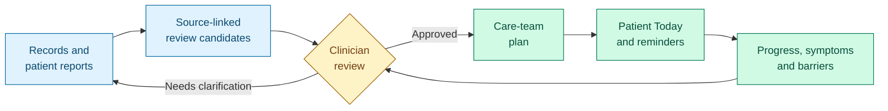
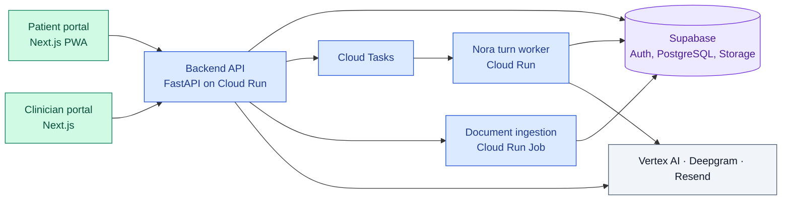

<p align="center">
  
</p>

# MediAgent

**Patient care between visits. Clinician decisions backed by evidence.**

MediAgent connects a mobile-first patient portal with a desktop clinician workspace.
Patients follow approved care plans, report symptoms, share records and contact
their care team. Clinicians review source evidence, reconcile records and decide
what becomes part of the patient's care.

Built as a San José State University master's project for outpatient chronic-care
and polypharmacy workflows. Demonstrations use fictional accounts and synthetic data.

[Patient portal](https://app.mediagent.live) ·
[Clinician portal](https://clinician.mediagent.live) ·
[Documentation](docs/README.md) · [Contributing](CONTRIBUTING.md) ·
[Project board](.agent/TASKS.md)

## Two portals, one care workflow

| MediAgent Care | MediAgent Pro |
| --- | --- |
| Mobile-first web app with home-screen installation | Desktop-first clinical workspace |
| Today feed with approved activities and reminders | Care-team plans with ownership and conflict review |
| Symptom reporting, text and voice conversations | Records, source evidence and medication reconciliation |
| Document upload and plain-language explanations | Document approval, symptom follow-up and ADR review |
| Private messages, visit offers and notifications | Patient roster, schedule, Review Queue and Alerts |
| American English and Mexican Spanish | English review with labelled translations and original evidence |

### From a record to an approved action



Imported data remains a candidate until the established review path approves it.
Reading a notification or replying to a message does not approve a plan or change
a medication. Each care team's instructions retain their ownership and provenance.

## System at a glance



The API owns authorization and workflow rules. Durable workers complete saved work
independently of a browser connection. The [architecture](.agent/ARCHITECTURE.md)
documents contracts, failure handling and limits.

## Run locally

Use **Python 3.12**, **Node.js 20** and **npm 10**. An authorized development
Supabase project is required. Docker and `psql` are needed for database contract
tests and migration work, not for every UI change.

### 1. Prepare configuration

```bash
git clone https://github.com/sjsu-masters-projects/medi-agent.git
cd medi-agent
npm ci
cp .env.example .env
cp apps/patient-portal/.env.example apps/patient-portal/.env.local
cp apps/clinician-portal/.env.example apps/clinician-portal/.env.local
```

Fill the templates from the team's secret store. Server credentials and public
portal settings are separate. Never put service-role credentials in a browser.
Copying templates does not activate optional integrations. See
[local development](docs/development.md) for configuration and troubleshooting.

### 2. Start the backend

In a terminal at the repository root:

```bash
python3.12 -m venv backend/.venv
backend/.venv/bin/python -m pip install -r backend/requirements-dev.txt
cd backend
PYTHONPATH=src .venv/bin/uvicorn app.main:app --reload --port 8000
```

### 3. Start each portal

In two separate terminals, starting at the repository root:

```bash
# Patient portal
cd apps/patient-portal
npm ci
npm run dev -- --port 3000
```

```bash
# Clinician portal
cd apps/clinician-portal
npm ci
npm run dev -- --port 3001
```

| Service | Local address |
| --- | --- |
| Patient portal | <http://localhost:3000> |
| Clinician portal | <http://localhost:3001> |
| Backend API reference | <http://localhost:8000/docs> |
| Backend health | <http://localhost:8000/health> |

Database setup is a separate, explicitly authorized step. Follow the
[migration guide](docs/supabase_setup_guide.md), not a copied list of SQL files.

## Repository map

| Path | Responsibility |
| --- | --- |
| [Patient portal](apps/patient-portal/README.md) | Patient screens, state and PWA assets |
| [Clinician portal](apps/clinician-portal/README.md) | Clinician and clinic-admin screens |
| [Backend](backend/README.md) | API, workflow services, safety rules, workers and migrations |
| `packages/shared/` | Shared TypeScript contracts and utilities |
| [Documentation](docs/README.md) | Setup, operating guides, references and verification evidence |
| [Product context](.agent/PROJECT.md) | Scope, architecture, requirements and task board |
| `scripts/` | Validation, migration and maintenance utilities |

## Checks and contribution

[CONTRIBUTING.md](CONTRIBUTING.md) lists the lint, type, test and build commands,
review expectations and documentation rules.

For a full dependency install and validation run in a clean checkout:

```bash
./scripts/bootstrap-and-validate.sh
```

This is a full quality-gate run, not an application launcher. Database contracts
need their documented local opt-in. Deployed acceptance is recorded separately in
the [evidence index](docs/evidence/README.md).

## Safety and project limits

- MediAgent provides supervised decision support. It does not diagnose, prescribe
  or replace a clinician. Nora's responses can be wrong and retain their product disclosures.
- Use synthetic or rigorously de-identified data. This project does not claim
  HIPAA compliance, regulatory approval or readiness for real clinical use.
- Messages are not continuously monitored. Emergency guidance is not a response guarantee.
- Source text, patient testimony and approved records remain distinct.
  A successful extraction is not clinical approval.
- MedWatch scope covers reviewable drafts and export, not submission to the FDA.
- Current implementation, open work and acceptance gaps belong in
  [TASKS.md](.agent/TASKS.md), not in another README checklist.

## License

Proprietary. All rights reserved.
