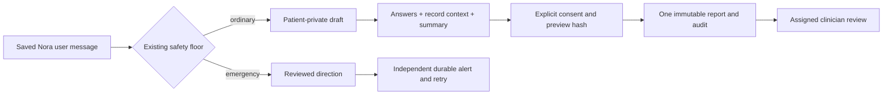

# PAT-002-B implementation and local acceptance — October 12, 2026

Implementation is on `feature/confirmed-symptom-intake`. B1–B11 code is implemented;
local automated evidence is below. Product activation/acceptance is still pending
actual question-library review and an authorized target rollout plus authenticated
manual verification. No approval, peer review, merge or deployed acceptance is claimed.
The requester authorized continuing all slices on October 12 without interim pauses.

## Behavior and boundary

Nora symptom classification opens a patient-private draft from a backend-saved user
turn. Manual start works without model extraction. Form answers never become chat
messages; the initial Nora message retains its existing transcript visibility.
The questions come from a pinned, paired-locale library, with a twelve-question ceiling.
Unknown/declined are explicit values, including null severity. Product details are
patient-supplied, not inferred from the chart. Optional model suggestions are not used.
The present candidate has no approved symptom-specific branch or positive red-flag
mapping; those require genuine review, not model-generated criteria.

The existing deterministic floor runs before ordinary work and on answers,
corrections, preview and confirmation. Structured positive mappings are allowed only
from the reviewed bundle and existing rule IDs. Reviewed direction is retained even
when persistence fails. Safety alerts are independent of symptom reports, durable
when their transaction succeeds, and retried by the existing worker. Stale revisions,
cancellation and ordinary intake/library failure cannot suppress that safety path.
A failed safety persistence response explicitly remains uncertain and is retryable.

Review separates patient answers, record context and a deterministic summary. An exact
patient-named product can select up to four active medications, five approved facts
about those medications and two exact cited excerpts of at most 500 characters.
No chart-wide or focused-document fetch occurs. Citations must be eligible clinician
entries or completed, shareable documents; patient-uploaded documents require approval.
Unreviewed/rejected facts, pending/rejected patient documents, other-patient sources and
specific-provider documents are excluded. Source versions, IDs, approval, purpose and
time are recorded. Reads mask stale context; preview/confirmation recheck sources under
row locks. Direct browser column privileges exclude stored preview/report content.
Clinician and SOAP responses retain testimony but omit cached retrieval context. Record context never supplies a patient answer or a suspected medication link.

Confirmation requires explicit boolean consent, expected revision, exact server preview
hash and a stable UUID. One database transaction creates one immutable report and its
append-only audit. Replays and concurrent keys recover that report. Corrections invalidate
preview/hash. Cancellation creates no report. New direct report inserts fail closed;
historical rows remain `legacy_unconfirmed`. SOAP, risk, MCP, chat context and cron
select confirmed reports. Delegated symptom tasks check confirmation and replace payload
testimony with the canonical owned report at submission/working transitions. No new
causality verdict, automatic ADR task, PR #136 follow-up, or PAT-002-C timeline is added.

The existing assigned-clinician patient detail view shows confirmed testimony and
labels legacy history. Unknown severity is labelled and a chart gap, never zero/mild.
A confirmed report is available for review; the UI does not claim an alert was delivered.

## Endpoint and recovery contract

All intake routes use the authenticated patient actor and `Cache-Control: private,
no-store`. No patient ID, approval, timezone or clinical preview can be supplied in
request bodies. There is no staff draft route.

| Method/path under `/api/v1/patients/me` | Request/meaning |
| --- | --- |
| `POST /symptom-intakes` | Owned saved source UUID and session; start or recover existing draft |
| `GET /symptom-intakes/active?session_id=default` | Latest owned state, including terminal state for reconnect recovery |
| `GET /symptom-intakes/{id}` | Owned authoritative draft and currently visible preview |
| `POST /symptom-intakes/{id}/answers` | Revision, stable mutation UUID, question ID, explicit state/value/wording/locale |
| `POST /symptom-intakes/{id}/preview` | Revision; server builds the preview |
| `POST /symptom-intakes/{id}/cancel` | Revision and stable mutation UUID |
| `POST /symptom-intakes/{id}/confirm` | Revision, stable confirmation UUID, preview hash, literal boolean true consent |
| `GET /symptom-reports/{id}` | Owned confirmed report; unavailable source context is masked |

The WebSocket sends only an intake ID/revision hint. REST remains authoritative when
a hint is missed. Pending writes retain the exact identity/payload in memory, without
automatic write retries. Reload resolves committed terminal state or preserves the
uncertain action for exact retry. Reads/writes are abortable and bounded in the panel;
session/account changes reject late results and clear private state. Confirmation consent
is bound to the displayed intake/revision/hash/locale and starts unchecked. Speech/text
alone never confirms. Unavailable libraries have no automatic-report fallback.

## Steps to see each increment

These commands use synthetic test injection and disposable local SQL eligibility.
They do **not** approve or activate the packaged candidate. Run backend commands from
`backend`; portal commands from the named portal directory.

| Slice | Exact follow-along path |
| --- | --- |
| B1 | Read plan section 17 and the October 10 acceptance record for the before/after source audit. |
| B2 | `PYTHONPATH=src .venv/bin/pytest tests/unit/safety/test_intake_gate.py tests/integration/routers/test_chat_emergency_copy.py tests/unit/services/test_chat_safety_service.py -q --no-cov`; verify bilingual direction and independent alert failures. |
| B3 | `PYTHONPATH=src .venv/bin/pytest tests/unit/intake/test_library.py -q --no-cov`; pending bundle refuses activation, rating starts unknown, product applicability stays bounded. |
| B4 | Run the opt-in SQL command below; check source/session/owner denial, one active draft, revision conflict, cancellation and browser write denial. |
| B5 | `PYTHONPATH=src .venv/bin/pytest tests/integration/routers/test_chat_api.py tests/integration/routers/test_chat_emergency_copy.py -q --no-cov`; routine classification opens a draft and creates no ADR task/report. |
| B6 | In `apps/patient-portal`, `NODE_OPTIONS=--no-experimental-webstorage npm run test -- src/__tests__/symptom-intake.test.tsx`; inspect both locales, blank severity, unknown/null, correction controls and cancellation copy. |
| B7 | SQL tests `test_context_budgets_exact_product_approval_and_withdrawal` and `test_private_and_unapproved_documents_are_not_preview_sources`; check source IDs, limits, approval and withdrawal. |
| B8 | SQL tests for confirm once/retry/conflict, simultaneous keys, confirm/cancel race and injected audit rollback. The service-to-real-SQL journey starts, answers, reviews, confirms and retries one report. |
| B9 | SQL reassignment and delegated-work tests; risk unknown-rating test; clinician portal `npm run lint`, `npm run typecheck`, and the test command below. Minimal summary is in the existing patient detail view. |
| B10 | Patient panel tests cover missed events, lost responses, terminal recovery, late account content, a hung read, labelled focus, both locales and consent. SQL safety-delivery outage/race tests retain then retry the alert exactly once. |
| B11 | Run the full commands below, then use the gated authenticated journey and rollout prerequisites. Local automation does not replace that journey. |

## Automated evidence

Exact commands and final observed results are recorded here. Existing dependency
locks were not changed. Backend uses Python 3.12.12; installed acquit is 0.2.0 versus
locked 0.3.0. Portals have Next 16.3.4 versus locked 16.3.6, React 19.2.3, TypeScript
5.9.3 and Vitest 4.1.11. This is existing installed-environment evidence, not a clean
locked-install claim. A reproducible clean install remains a review prerequisite.

| Directory/command | Observed result |
| --- | --- |
| backend: `.venv/bin/ruff check src/` | Passed |
| backend: `.venv/bin/ruff format --check src/` | 222 files already formatted |
| backend: `.venv/bin/mypy src/ --ignore-missing-imports` | Passed, 222 source files |
| backend: `PYTHONPATH=src .venv/bin/pytest tests/ -q` | 2,108 passed, 154 skipped; 86.06% coverage |
| backend: `.venv/bin/python scripts/validate_migrations.py` | 59 PostgreSQL migration files parsed |
| backend: `PYTHONPATH=src SYMPTOM_INTAKE_TEST_POSTGRES=1 CHAT_SAFETY_TEST_POSTGRES=1 CHAT_SAFETY_TEST_POSTGRES_DOCKER=1 .venv/bin/pytest tests/integration/test_symptom_intake_postgres.py tests/integration/test_chat_safety_postgres.py -q --no-cov` | 25 passed (17 intake, 8 safety) |
| patient portal: `npm run lint`; `npm run typecheck` | Passed |
| patient portal: `NODE_OPTIONS=--no-experimental-webstorage npm run test` | 388 passed, 46 files |
| patient portal: `npm run build -- --webpack` | Passed |
| clinician portal: `npm run lint`; `npm run typecheck` | Passed |
| clinician portal: `NODE_OPTIONS=--no-experimental-webstorage npm run test` | 260 passed, 38 files |
| clinician portal: `npm run build -- --webpack` | Passed |
| root: `git diff --check` | Passed |

SQL tests use cached `postgres:16-alpine`, `--pull=never`, `--network=none`, no host
ports/mounts and disposable databases. They use minimal auth/platform stubs and selected
actual migrations, not the full deployed Supabase stack. The service journey substitutes
only the transport to local PostgreSQL; real service business rules and SQL transactions
run, while real PostgREST/Auth are not claimed. Containers are removed after the run.

Earlier failures were corrected and rerun: stale automatic-ADR test expectations,
PostgREST filter order, SQL fixture dosage/idempotency fields, and duplicate accessible
field/group labels. Docker was blocked in the sandbox and passed with reviewed local
execution. Node's experimental Web Storage caused two clinician jsdom failures; the
explicit Node option passed without changing production auth code. Webpack builds are
used because the earlier default Turbopack build hit a sandbox port restriction.
Existing SDK/Sentry/Vite deprecation warnings remain. Whole-tests Ruff/format had known
pre-existing failures in B2; scoped changed Python checks pass. No dependency installation,
remote migration, remote seed/reset, deployment or merge occurred.

## Remaining prerequisites and authenticated manual journey

1. Obtain actual designated safety/backend review of both locales, question ordering,
   applicability, red-flag mappings and any symptom-specific branch. Record the real
   reference/reviewer identity/role/date and immutable version/hash. The current manifest
   has `active_version: null` and `pending_review`; do not label fixtures as approval.
2. Review migration 060 and perform an explicitly authorized rollout of 059/060 with
   checksums and least-privilege verification. Drain/retire old direct symptom writers
   first. Historical rows are not retroactively confirmed. Do not revert to automatic
   report writes during rollback; leave intake disabled and preserve confirmed reports.
3. Through that authorized rollout, install matching genuine database eligibility and
   publish the reviewed immutable packaged bundle. Set `SYMPTOM_INTAKE_ENABLED=true`
   only after all three gates agree. Review lockfile reproducibility and CI checks.
4. Sign in as a fictional patient in an approved synthetic environment. Open Nora;
   send a new non-emergency symptom message (or choose **Start a symptom draft** after
   a saved turn). Historic unbound turns cannot start a draft. Select severity or choose
   **I don’t know** / **Prefer not to answer**. Supply suspected product details only
   if actually part of the fictional patient's account. Refresh and verify recovery.
5. Complete applicable questions; choose **Review before sharing**. Identify patient
   testimony, context citations and summary. Correct an answer, rebuild the preview,
   then explicitly check consent and choose **Confirm and share with my care team**.
   Verify exactly one report with null severity if unknown and a confirmation audit.
6. As the actively assigned fictional clinician, open the existing patient detail and
   expand the confirmed summary. Verify unknown labels. Reassign/remove that assignment
   and verify denial, using authorized synthetic setup changes. Draft answers must remain
   absent from clinical consumers. Confirmation must not create an automatic ADR verdict.
7. Repeat in Mexican Spanish at 320/375-pixel widths with keyboard and touch. Check focus,
   readable wrapping, zoom and no horizontal overflow. Test voice-to-text as input only.
   Simulate lost responses, reconnect, account switches and alert delivery outage; verify
   same report/identity and honest pending/delivery states. Try existing bilingual reviewed
   emergency phrases; observe direction before ordinary work and required alert retry.

Steps 4–7 and visual narrow-screen/touch verification have **not** been performed in
an authenticated deployed browser. They are explicit remaining acceptance checks, not
invented evidence. No real patient data should be used.

## PAT-002-C and ADR handoff

### Nora browser follow-up

October 12 local Chrome inspection reproduced a conversation growing past 11,000
pixels, with the composer below the viewport and fixed bottom navigation. The
chat route now bounds the app shell to the viewport, scrolls its conversation
internally and reserves space for the navigation. Initial draft-read failures
are distinguished from uncertain writes, preserve server library error codes,
and clear the previous error while reloading. A failed read does not offer a
new draft before recovery. The focused patient panel/chat run passed 38 tests.
Post-rebase full checks and final browser verification are pending; this does
not establish intake activation, report confirmation or deployed acceptance.

To repeat: open Nora with an existing synthetic conversation, scroll to both
ends and verify that the composer remains above navigation. Reload draft state
and check that loading and failure are distinct. Repeat at 320/375 pixels.

C can consume confirmed reports with `report_schema_version`, immutable
`confirmed_content`, `intake_id`, patient confirmation actor/time and nullable severity.
The private draft is not a timeline source. Preserve unknown/declined/not-applicable
states, source attribution and legacy labels. The B clinician change is only the existing
summary; the full patient timeline and expanded detail are C. PR #136's ADR follow-up
implementation remains outside this branch's scope.

## Rebase onto October 12 main

The original feature commit was `2d768c0`; `origin/main` is now `62a1945`.
The pre-rebase commands and counts above describe the original baseline. Current
upstream includes the Nora inbox/conversations, citations and PR #136 ADR follow-up;
those existing implementations are preserved rather than reimplemented here.
Intake reads and source starts now follow the active Nora session and discard late
content across conversation changes. The current composer fix uses the upstream
thread view, which already hides bottom navigation while a conversation is open.

The unpublished migrations are now `059_chat_safety_alerts.sql` and
`060_confirmed_symptom_intake.sql`, following upstream 058. Migration 051 owns the
chat session column; 060 reuses it. Both sides of a safety turn retain that same
session. Historical 049/050 references in the plan and October 10 record identify
the earlier local test files, not deployed migrations. No remote migration occurred.
Post-rebase verification passed with the following final commands/outcomes:

| Scope | Command | Result |
| --- | --- | --- |
| Backend dependencies | `.venv/bin/pip install --disable-pip-version-check --no-input -r requirements-dev.txt`; `.venv/bin/pip check` | Pinned requirements synchronized; no broken requirements. This is an existing virtualenv, not a fresh-venv claim. |
| Each portal dependencies | `npm ci --no-audit --no-fund` | Both clean locked installs passed; Next 16.3.8. No lockfiles changed. |
| Backend tests | `PYTHONPATH=src .venv/bin/pytest tests/ -q` | 2,505 passed, 243 skipped; 88.15% coverage. Native PostgreSQL and opt-in/environment-dependent tests account for skips; they are not claimed as passes. |
| Backend lint/format | `.venv/bin/ruff check src/ scripts/`; `.venv/bin/ruff format --check src/ scripts/` | Passed; 263 files formatted. All 32 changed Python files also pass scoped lint/format. |
| Backend types | `.venv/bin/mypy src/ --ignore-missing-imports` | Passed; 245 source files. |
| Migrations/placeholders | `.venv/bin/python scripts/validate_migrations.py`; `.venv/bin/python scripts/check_production_placeholders.py` | 72 migrations parsed; production placeholder check passed. |
| Local intake/safety SQL | The opt-in two-file PostgreSQL command above | 25 passed, including non-default session identity and cross-session retry denial. Actual migration 051 now precedes 059/060 in the disposable fixtures. |
| Patient portal | `npm run lint`; `npm run typecheck`; `NODE_OPTIONS=--no-experimental-webstorage npm run test` | Passed; 525 tests in 59 files. |
| Clinician portal | Same portal commands | Passed; 341 tests in 46 files, including confirmed/legacy testimony and unknown severity. |
| Both portal production builds | `npm run build -- --webpack` | Passed on Next 16.3.8. Initial sandbox runs could not resolve Google Fonts; network-enabled reruns passed without font mocks or source changes. |

Local authenticated Chrome inspection opened an existing synthetic Nora conversation.
At 1512×857, 375×812 and 320×640 the page matched the viewport height and width;
the long conversation scrolled inside its 697-pixel desktop area and the composer
remained fully visible. The 320-pixel textarea accepted keyboard focus and an unsent
layout-check value, which was cleared without submitting. Screenshots are local
artifacts in `output/verification/nora-rebase-*-2026-10-12.jpg`; they are not committed.
The temporary viewport override was reset.

The current target still reports draft recovery unavailable, and its chat connection
was observed switching between Connected and Offline. No live symptom report was
submitted or confirmed, and no diagnosis of that connection failure is claimed.
This is layout/error-state evidence only. Question approval, authorized 059/060
rollout, a compatible running backend and the full patient/clinician confirmation
journey remain prerequisites. Existing SDK/Sentry/Vite and workspace-root warnings
remain. The earlier dependency drift is historical; Acquit is now 0.3.0 and both
portal environments were freshly installed from current main's locks.
