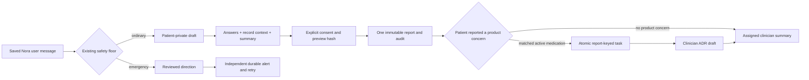

# PAT-002-B implementation and local acceptance — October 12, 2026

Implementation is on `feature/confirmed-symptom-intake`. B1–B11 code is implemented;
local automated evidence is below. On October 12 the requester reported Ganesh's
same-day approval of the unchanged paired-language candidate. The pinned manifest,
matching database eligibility and local backend flag were activated, then the
authenticated synthetic patient and assigned-clinician path was exercised below.
This is local functional evidence, not a recorded GitHub peer approval, merge,
deployment or deployed acceptance.
The requester authorized continuing all slices on October 12 without interim pauses.

## Behavior and boundary

Nora symptom classification opens a patient-private draft from a backend-saved user
turn. Manual start works without model extraction. Form answers never become chat
messages; the initial Nora message retains its existing transcript visibility.
The questions come from a pinned, paired-locale library, with a twelve-question ceiling.
Unknown/declined are explicit values, including null severity. Product details are
patient-supplied, not inferred from the chart. Optional model suggestions are not used.
The approved candidate has no symptom-specific branch or positive red-flag mapping;
none was generated from model output.



The existing deterministic floor runs before ordinary work and on answers,
corrections, preview and confirmation. Structured positive mappings are allowed only
from the reviewed bundle and existing rule IDs. Reviewed direction is retained even
when persistence fails. Safety alerts are independent of symptom reports, durable
when their transaction succeeds, and retried by the existing worker. Stale revisions,
cancellation and ordinary intake/library failure cannot suppress that safety path.
A failed safety persistence response explicitly remains uncertain and is retryable.

Review separates patient answers, record context and a deterministic summary. An exact
patient-named product can select up to four active medications, five approved facts
about those medications and two exact cited excerpts of at most 500 characters.
No chart-wide or focused-document fetch occurs. Citations must be eligible clinician
entries or completed, shareable documents; patient-uploaded documents require approval.
Unreviewed/rejected facts, pending/rejected patient documents, other-patient sources and
specific-provider documents are excluded. Source versions, IDs, approval, purpose and
time are recorded. Reads mask stale context; preview/confirmation recheck sources under
row locks. Direct browser column privileges exclude stored preview/report content.
Clinician and SOAP responses retain testimony but omit cached retrieval context. Record context never supplies a patient answer or a suspected medication link.

Confirmation requires explicit boolean consent, expected revision, exact server preview
hash and a stable UUID. One database transaction creates one immutable report and its
append-only audit. Replays and concurrent keys recover that report. Corrections invalidate
preview/hash. Cancellation creates no report. New direct report inserts fail closed;
historical rows remain `legacy_unconfirmed`. SOAP, risk, MCP, chat context and cron
select confirmed reports. Delegated symptom tasks check confirmation and replace payload
testimony with the canonical owned report at submission/working transitions. A confirmed
patient-reported product concern now starts one report-keyed pharmacovigilance task when
the approved preview context contains the matching active medication. That task creates
an auditable draft for clinician review; it does not create a causality verdict or a
MedWatch submission. An unlisted product remains preserved as patient testimony but does
not receive another patient's medication ID. PAT-002-C's timeline is not added.

The existing assigned-clinician patient detail view shows confirmed testimony and
labels legacy history. Unknown severity is labelled and a chart gap, never zero/mild.
A confirmed report is available for review; the UI does not claim an alert was delivered.

## October 17 defect follow-up

Local end-to-end testing found two integration defects. A safety notice from one Nora
conversation survived the **New chat** transition, and explicit confirmation stopped
after saving the report instead of invoking the existing pharmacovigilance boundary.
The patient hook now clears the notice as part of every conversation switch and ignores
late events from the disconnected socket. Confirmation reads the canonical owned report,
recognizes only the patient's explicit product-concern answer, and submits an idempotent
task keyed by the confirmed report UUID. Medication linkage comes only from the bounded
active-medication context already shown in the confirmed preview. Migration 076 creates
the submitted task in the report-confirmation transaction; the existing worker now claims
never-started tasks as well as scheduled retries. Repeated/concurrent confirmation cannot
reopen completed work or reset a clinician-reviewed assessment to `draft`.

Focused verification on October 17 passed: 38 backend service/intake tests, 63 patient
chat tests, Ruff on all changed Python files, mypy on both changed backend services,
patient-portal ESLint/typecheck and the 79-file migration validator. The monolithic backend
run reached 3,169 passed and 318 skipped before the repository session-timeout hook stopped
it at 95%; all remaining files passed separately (169 tests, including the partly run file).
The Docker PostgreSQL suite could not run on this host because Docker and a PostgreSQL
server are unavailable; its new confirmation-to-outbox case remains an opt-in CI check.
No remote migration was applied. The default-off activation decision, conversational
one-question-at-a-time redesign, and unlisted-medication review linkage remain open.

## Endpoint and recovery contract

All intake routes use the authenticated patient actor and `Cache-Control: private,
no-store`. No patient ID, approval, timezone or clinical preview can be supplied in
request bodies. There is no staff draft route.

| Method/path under `/api/v1/patients/me` | Request/meaning |
| --- | --- |
| `POST /symptom-intakes` | Owned saved source UUID and session; start or recover existing draft |
| `GET /symptom-intakes/active?session_id=default` | Latest owned state, including terminal state for reconnect recovery |
| `GET /symptom-intakes/{id}` | Owned authoritative draft and currently visible preview |
| `POST /symptom-intakes/{id}/answers` | Revision, stable mutation UUID, question ID, explicit state/value/wording/locale |
| `POST /symptom-intakes/{id}/preview` | Revision; server builds the preview |
| `POST /symptom-intakes/{id}/cancel` | Revision and stable mutation UUID |
| `POST /symptom-intakes/{id}/confirm` | Revision, stable confirmation UUID, preview hash, literal boolean true consent |
| `GET /symptom-reports/{id}` | Owned confirmed report; unavailable source context is masked |

The WebSocket sends only an intake ID/revision hint. REST remains authoritative when
a hint is missed. Pending writes retain the exact identity/payload in memory, without
automatic write retries. Reload resolves committed terminal state or preserves the
uncertain action for exact retry. Reads/writes are abortable and bounded in the panel;
session/account changes reject late results and clear private state. Confirmation consent
is bound to the displayed intake/revision/hash/locale and starts unchecked. Speech/text
alone never confirms. Unavailable libraries have no automatic-report fallback.

## Steps to see each increment

These commands use synthetic test injection and disposable local SQL eligibility.
They do **not** approve or activate the packaged candidate. Run backend commands from
`backend`; portal commands from the named portal directory.

| Slice | Exact follow-along path |
| --- | --- |
| B1 | Read plan section 17 and the October 10 acceptance record for the before/after source audit. |
| B2 | `PYTHONPATH=src .venv/bin/pytest tests/unit/safety/test_intake_gate.py tests/integration/routers/test_chat_emergency_copy.py tests/unit/services/test_chat_safety_service.py -q --no-cov`; verify bilingual direction and independent alert failures. |
| B3 | `PYTHONPATH=src .venv/bin/pytest tests/unit/intake/test_library.py -q --no-cov`; pending bundle refuses activation, rating starts unknown, product applicability stays bounded. |
| B4 | Run the opt-in SQL command below; check source/session/owner denial, one active draft, revision conflict, cancellation and browser write denial. |
| B5 | `PYTHONPATH=src .venv/bin/pytest tests/integration/routers/test_chat_api.py tests/integration/routers/test_chat_emergency_copy.py -q --no-cov`; routine classification opens a draft and creates no ADR task/report. |
| B6 | In `apps/patient-portal`, `NODE_OPTIONS=--no-experimental-webstorage npm run test -- src/__tests__/symptom-intake.test.tsx`; inspect both locales, blank severity, unknown/null, correction controls and cancellation copy. |
| B7 | SQL tests `test_context_budgets_exact_product_approval_and_withdrawal` and `test_private_and_unapproved_documents_are_not_preview_sources`; check source IDs, limits, approval and withdrawal. |
| B8 | SQL tests for confirm once/retry/conflict, simultaneous keys, confirm/cancel race and injected audit rollback. The service-to-real-SQL journey starts, answers, reviews, confirms and retries one report. |
| B9 | SQL reassignment and delegated-work tests; risk unknown-rating test; clinician portal `npm run lint`, `npm run typecheck`, and the test command below. Minimal summary is in the existing patient detail view. |
| B10 | Patient panel tests cover missed events, lost responses, terminal recovery, late account content, a hung read, labelled focus, both locales and consent. SQL safety-delivery outage/race tests retain then retry the alert exactly once. |
| B11 | Run the full commands below, then use the gated authenticated journey and rollout prerequisites. Local automation does not replace that journey. |

## Automated evidence

Exact commands and final observed results are recorded here. Existing dependency
locks were not changed. Backend uses Python 3.12.12; installed acquit is 0.2.0 versus
locked 0.3.0. Portals have Next 16.3.4 versus locked 16.3.6, React 19.2.3, TypeScript
5.9.3 and Vitest 4.1.11. This is existing installed-environment evidence, not a clean
locked-install claim. A reproducible clean install remains a review prerequisite.

| Directory/command | Observed result |
| --- | --- |
| backend: `.venv/bin/ruff check src/` | Passed |
| backend: `.venv/bin/ruff format --check src/` | 222 files already formatted |
| backend: `.venv/bin/mypy src/ --ignore-missing-imports` | Passed, 222 source files |
| backend: `PYTHONPATH=src .venv/bin/pytest tests/ -q` | 2,108 passed, 154 skipped; 86.06% coverage |
| backend: `.venv/bin/python scripts/validate_migrations.py` | 59 PostgreSQL migration files parsed |
| backend: `PYTHONPATH=src SYMPTOM_INTAKE_TEST_POSTGRES=1 CHAT_SAFETY_TEST_POSTGRES=1 CHAT_SAFETY_TEST_POSTGRES_DOCKER=1 .venv/bin/pytest tests/integration/test_symptom_intake_postgres.py tests/integration/test_chat_safety_postgres.py -q --no-cov` | 25 passed (17 intake, 8 safety) |
| patient portal: `npm run lint`; `npm run typecheck` | Passed |
| patient portal: `NODE_OPTIONS=--no-experimental-webstorage npm run test` | 388 passed, 46 files |
| patient portal: `npm run build -- --webpack` | Passed |
| clinician portal: `npm run lint`; `npm run typecheck` | Passed |
| clinician portal: `NODE_OPTIONS=--no-experimental-webstorage npm run test` | 260 passed, 38 files |
| clinician portal: `npm run build -- --webpack` | Passed |
| root: `git diff --check` | Passed |

SQL tests use cached `postgres:16-alpine`, `--pull=never`, `--network=none`, no host
ports/mounts and disposable databases. They use minimal auth/platform stubs and selected
actual migrations, not the full deployed Supabase stack. The service journey substitutes
only the transport to local PostgreSQL; real service business rules and SQL transactions
run, while real PostgREST/Auth are not claimed. Containers are removed after the run.

Earlier failures were corrected and rerun: stale automatic-ADR test expectations,
PostgREST filter order, SQL fixture dosage/idempotency fields, and duplicate accessible
field/group labels. Docker was blocked in the sandbox and passed with reviewed local
execution. Node's experimental Web Storage caused two clinician jsdom failures; the
explicit Node option passed without changing production auth code. Webpack builds are
used because the earlier default Turbopack build hit a sandbox port restriction.
Existing SDK/Sentry/Vite deprecation warnings remain. Whole-tests Ruff/format had known
pre-existing failures in B2; scoped changed Python checks pass. No dependency installation,
remote migration, remote seed/reset, deployment or merge occurred.

## Activation and authenticated manual journey

1. **Library gate completed for the local synthetic check:** the requester reported
   Ganesh Thampi approved the opened `candidate-1` package on October 12. The
   [approval record](../backend/src/app/intake/question_library/candidate-1-review.md#requester-reported-approval)
   names its unchanged canonical hash and distinguishes that report from a reviewer
   signature or PR approval. `manifest.json` selects that exact version/hash.
2. **Target schema checked:** the requester applied 059/060. Read-only ledger checks
   matched their versioned checksums, the confirmation column was available and the
   unknown-patient intake RPC denied access. Old direct writers still need release
   coordination before any production rollout; historical rows remain unconfirmed.
3. **Local activation completed:** matching approval metadata were published via
   `set_symptom_question_eligibility`; the backend was restarted with
   `SYMPTOM_INTAKE_ENABLED=true` for local verification. This does not set a deployed
   service flag. Lockfile reproducibility and the final PR/CI review remain open.
4. Sign in as a fictional patient in an approved synthetic environment. Open Nora;
   send a new non-emergency symptom message (or choose **Start a symptom draft** after
   a saved turn). Historic unbound turns cannot start a draft. Select severity or choose
   **I don’t know** / **Prefer not to answer**. Supply suspected product details only
   if actually part of the fictional patient's account. Refresh and verify recovery.
5. Complete applicable questions; choose **Review before sharing**. Identify patient
   testimony, context citations and summary. Correct an answer, rebuild the preview,
   then explicitly check consent and choose **Confirm and share with my care team**.
   Verify exactly one report with null severity if unknown and a confirmation audit.
6. As the actively assigned fictional clinician, open the existing patient detail and
   expand the confirmed summary. Verify unknown labels. Reassign/remove that assignment
   and verify denial, using authorized synthetic setup changes. Draft answers must remain
   absent from clinical consumers. Confirmation must not create an automatic ADR verdict.
7. Repeat in Mexican Spanish at 320/375-pixel widths with keyboard and touch. Check focus,
   readable wrapping, zoom and no horizontal overflow. Test voice-to-text as input only.
   Simulate lost responses, reconnect, account switches and alert delivery outage; verify
   same report/identity and honest pending/delivery states. Try existing bilingual reviewed
   emergency phrases; observe direction before ordinary work and required alert retry.

Steps 4–5 and the assigned-clinician summary in step 6 were performed locally on
October 12; exact observations are recorded in the latest section below. Live
reassignment denial, authenticated touch/voice and outage injection in steps 6–7
remain open. No authenticated deployed acceptance is claimed. Use only synthetic data.

## PAT-002-C and ADR handoff

### Nora browser follow-up

October 12 local Chrome inspection reproduced a conversation growing past 11,000
pixels, with the composer below the viewport and fixed bottom navigation. The
chat route now bounds the app shell to the viewport, scrolls its conversation
internally and reserves space for the navigation. Initial draft-read failures
are distinguished from uncertain writes, preserve server library error codes,
and clear the previous error while reloading. A failed read does not offer a
new draft before recovery. The focused patient panel/chat run passed 38 tests.
Post-rebase full checks and final browser verification are pending; this does
not establish intake activation, report confirmation or deployed acceptance.

To repeat: open Nora with an existing synthetic conversation, scroll to both
ends and verify that the composer remains above navigation. Reload draft state
and check that loading and failure are distinct. Repeat at 320/375 pixels.

C can consume confirmed reports with `report_schema_version`, immutable
`confirmed_content`, `intake_id`, patient confirmation actor/time and nullable severity.
The private draft is not a timeline source. Preserve unknown/declined/not-applicable
states, source attribution and legacy labels. The B clinician change retains the existing
summary; the full patient timeline and expanded detail are C. An eligible confirmed product
concern now invokes the existing PR #136 pharmacovigilance boundary to create its
clinician-review draft; it does not submit MedWatch.

## Rebase onto October 12 main

The original feature commit was `2d768c0`; `origin/main` is now `62a1945`.
The pre-rebase commands and counts above describe the original baseline. Current
upstream includes the Nora inbox/conversations, citations and PR #136 ADR follow-up;
those existing implementations are preserved rather than reimplemented here.
Intake reads and source starts now follow the active Nora session and discard late
content across conversation changes. The current composer fix uses the upstream
thread view, which already hides bottom navigation while a conversation is open.

The unpublished migrations are now `059_chat_safety_alerts.sql` and
`060_confirmed_symptom_intake.sql`, following upstream 058. Migration 051 owns the
chat session column; 060 reuses it. Both sides of a safety turn retain that same
session. Historical 049/050 references in the plan and October 10 record identify
the earlier local test files, not deployed migrations. No remote migration occurred.
Post-rebase verification passed with the following final commands/outcomes:

| Scope | Command | Result |
| --- | --- | --- |
| Backend dependencies | `.venv/bin/pip install --disable-pip-version-check --no-input -r requirements-dev.txt`; `.venv/bin/pip check` | Pinned requirements synchronized; no broken requirements. This is an existing virtualenv, not a fresh-venv claim. |
| Each portal dependencies | `npm ci --no-audit --no-fund` | Both clean locked installs passed; Next 16.3.8. No lockfiles changed. |
| Backend tests | `PYTHONPATH=src .venv/bin/pytest tests/ -q` | 2,505 passed, 243 skipped; 88.15% coverage. Native PostgreSQL and opt-in/environment-dependent tests account for skips; they are not claimed as passes. |
| Backend lint/format | `.venv/bin/ruff check src/ scripts/`; `.venv/bin/ruff format --check src/ scripts/` | Passed; 263 files formatted. All 32 changed Python files also pass scoped lint/format. |
| Backend types | `.venv/bin/mypy src/ --ignore-missing-imports` | Passed; 245 source files. |
| Migrations/placeholders | `.venv/bin/python scripts/validate_migrations.py`; `.venv/bin/python scripts/check_production_placeholders.py` | 72 migrations parsed; production placeholder check passed. |
| Local intake/safety SQL | The opt-in two-file PostgreSQL command above | 25 passed, including non-default session identity and cross-session retry denial. Actual migration 051 now precedes 059/060 in the disposable fixtures. |
| Patient portal | `npm run lint`; `npm run typecheck`; `NODE_OPTIONS=--no-experimental-webstorage npm run test` | Passed; 525 tests in 59 files. |
| Clinician portal | Same portal commands | Passed; 341 tests in 46 files, including confirmed/legacy testimony and unknown severity. |
| Both portal production builds | `npm run build -- --webpack` | Passed on Next 16.3.8. Initial sandbox runs could not resolve Google Fonts; network-enabled reruns passed without font mocks or source changes. |

Local authenticated Chrome inspection opened an existing synthetic Nora conversation.
At 1512×857, 375×812 and 320×640 the page matched the viewport height and width;
the long conversation scrolled inside its 697-pixel desktop area and the composer
remained fully visible. The 320-pixel textarea accepted keyboard focus and an unsent
layout-check value, which was cleared without submitting. Screenshots are local
artifacts in `output/verification/nora-rebase-*-2026-10-12.jpg`; they are not committed.
The temporary viewport override was reset.

The current target still reports draft recovery unavailable, and its chat connection
was observed switching between Connected and Offline. No live symptom report was
submitted or confirmed, and no diagnosis of that connection failure is claimed.
This is layout/error-state evidence only. Question approval, authorized 059/060
rollout, a compatible running backend and the full patient/clinician confirmation
journey remain prerequisites. Existing SDK/Sentry/Vite and workspace-root warnings
remain. The earlier dependency drift is historical; Acquit is now 0.3.0 and both
portal environments were freshly installed from current main's locks.

Draft review: [PR #159](https://github.com/sjsu-masters-projects/medi-agent/pull/159).
Source/verification commit: `9982311` on base `62a1945`; later review-link updates
are documentation only. Local results above are not a claim that remote CI passed.

## Nora scrolling follow-up — October 12

The requester reported repeated scrolling after the bounded-height layout fix.
The connection effect cleared messages on every retry, collapsing the long thread,
and the page restarted smooth scrolling on every history replacement/stream chunk.
The same patient/session now retains history during recovery, including REST failure;
changing patient/session still clears it. Late events from a replaced socket are ignored.
The page follows new content instantly when near the bottom, pauses when the reader
scrolls up, resumes at the bottom or on typed send, and resets on conversation selection.
It also avoids pulling focus away from controls inside the conversation.

In `apps/patient-portal`:

- `npm run test -- src/__tests__/chat-page.test.tsx`: initial three regression cases
  passed with all 38 tests; the final expanded suite is included in the full run below.
- `npm run test`: **530 passed in 59 files**, including 40 chat-page tests covering
  bilingual streaming, pending/failed reconnect recovery and stale prior-session events.
- `npm run lint`, `npm run typecheck`, `npm run build -- --webpack`: passed.

Authenticated synthetic browser observation: the Oct 6 long conversation opened at
the bottom. After scrolling up, its offset remained **7083 px** across subsequent
reconnect activity. At 375×812 the offset stayed unchanged, the page remained
375×812 and the composer ended at y=812. Desktop and mobile screenshots are local
`output/verification/nora-scroll-stable-*-2026-10-12.jpg` artifacts, not uploaded or committed.
The viewport override was reset. No clinical message or report was submitted.
The target continued to show Offline and unavailable draft recovery; the cause of
connection failure and full live confirmation acceptance remain unverified.

To see the fix:

1. Open the locally running patient portal, choose Chat, then **Conversation Oct 6**
   (or another long synthetic Nora conversation).
2. It should open at the latest message. Scroll up several screens and wait through
   connection retries: history should remain visible and should not pull you down.
3. In a functioning chat connection, send a synthetic message and observe the reply
   following the bottom without repeated scroll animations. Scroll up during a reply:
   the reading position should remain; return to the bottom to resume following.
4. Select another Nora conversation or New chat: its latest content should be shown.
   Repeat at a narrow width; the composer should remain visible.

Step 3 is covered by socket-driven tests, not a successful live message in this target.

## Nora connection follow-up — October 12

The requester reported continuous Connected/Offline toggling. A read-only schema
probe returning zero rows confirmed SQL code `42703` for
`symptom_reports.confirmation_state`, and `PGRST205` for `symptom_intakes`: migration
060 is absent from this target. The confirmed-only context query ran during socket
initialization after acceptance and history delivery, terminating the connection.
The client reset its retry counter on every open, allowing repeated short-lived
connections to retry indefinitely.

The context reader now handles only the missing confirmation column by omitting
symptom reports, retaining other readable context, and exposing
`recent_symptoms_available=false` to the model's record tool. This explicitly means
unavailable rather than no symptoms; legacy/unconfirmed rows are never substituted.
Unrelated database errors remain errors. Other initialization failures emit a safe
generic error and close with 1011. The client resets its retry budget only after
five seconds of sustained connection, with cleanup on close/error/session change;
repeated immediate open/close cycles stop after five retries.

Verification commands and outcomes:

- From `backend`: `PYTHONPATH=src .venv/bin/pytest tests/unit/services/test_chat_service.py tests/unit/adk/test_tools.py tests/integration/routers/test_chat_api.py tests/integration/routers/test_chat_websocket_stability.py tests/integration/routers/test_chat_document_focus.py tests/integration/routers/test_chat_emergency_copy.py -q --no-cov`: **86 passed**.
- `.venv/bin/ruff check src/ tests/unit/services/test_chat_service.py tests/unit/adk/test_tools.py tests/integration/routers/test_chat_websocket_stability.py` and the same paths with `.venv/bin/ruff format --check`: passed (248 formatted files).
  `.venv/bin/mypy src/app/services/chat_service.py src/app/adk/tools/patient_context.py src/app/routers/chat.py --ignore-missing-imports`: passed.
- From `apps/patient-portal`: `npm run test`: **532 passed in 59 files**, including
  42 chat tests and bounded retry/healthy recovery regressions. `npm run lint`,
  `npm run typecheck`, `npm run build -- --webpack`: passed.
- The running local backend reloaded the changes. The authenticated synthetic
  browser showed Connected on subsequent checks separated by test execution;
  `output/verification/nora-connected-2026-10-12.jpg` is local screenshot evidence.

To see it: reopen **Chat → Conversation Oct 6**, then leave it idle for at least
a minute. The connection should stay Connected and the existing history should
remain readable. A deliberately unavailable backend should eventually stop retrying
and remain Offline rather than keep cycling. The latter case is tested with mock
sockets; the shared backend was not deliberately stopped for manual testing.

Earlier Offline observations above are historical. Draft recovery still reports
unavailable because the intake schema is absent. No remote migration/data change,
new clinical message, symptom confirmation or genuine question approval was performed.
Full intake activation and patient/clinician acceptance remain pending.

## Headache intake availability recheck — October 12

The requester reported “Guided symptom intake is unavailable. No symptom report was
saved.” after describing a headache. The symptom route attempts `start`, which checks
the runtime enablement and approved packaged library before ordinary draft creation.
A fresh local backend configuration check resolves `symptom_intake_enabled=false`;
the manifest still has `active_version=null`, `pending_review` and no approval.
`load_library()` returns `INTAKE_LIBRARY_UNAVAILABLE`. These are confirmed activation
blockers, not a headache-specific question failure. This check reads the configuration
through the application and emits only the boolean, not credential/configuration contents.

The target's schema state has changed since the earlier missing-column observation:
a zero-row read of `symptom_reports.confirmation_state` now succeeds. A direct
zero-row read of `symptom_intakes.id` returns `42501`, consistent with migration 060's
intentional service-role table-access revocation and RPC-only draft access. That denial
does not establish a missing table. The complete migration ledger/checksums, database
eligibility and running process overrides were not verified in this recheck.

No migration, eligibility publication, feature activation or approval was performed.
Actual paired-locale review and a matching approved bundle/manifest/database eligibility
remain necessary before enabling intake and restarting the backend. The ordinary chat
message and an explicitly confirmed symptom report remain separate artifacts.

## Requester migration rollout recheck — October 12

The requester reported running the migration. Read-only ledger queries now confirm
`059_chat_safety_alerts.sql` and `060_confirmed_symptom_intake.sql` are both recorded
with checksums matching the local versioned files. Zero-row confirmation-column reads
succeed. Calling the intake RPC's read-only `active` action for the nil/unknown patient
returns `42501`, demonstrating the expected unknown-patient denial without creating
an account, draft or report. No migration was applied during this recheck.

The packaged `candidate-1` parses with twelve questions, budget twelve, complete
en-US/es-MX wording and canonical SHA-256
`a7ee7f3c7bfd91fdbf3fccba56fb42af86176801895ca0d70ad3c99ffd0917ab`.
That is content/structure evidence, not approval. The manifest still has no approved
active version and a fresh local configuration check resolves intake off.
The [review worksheet](../backend/src/app/intake/question_library/candidate-1-review.md)
presents both locales and explicit branch/red-flag review decisions. It records no
reviewer approval. The requester was asked for the actual decision/reference.

At the start of this recheck no process listened on 8000, 3000 or 3001. Local apps
were started using these commands from the respective app directories:

```bash
# backend — background retry disabled during verification
A2A_RETRY_WORKER_ENABLED=false PYTHONPATH=src .venv/bin/uvicorn app.main:app --host 127.0.0.1 --port 8000 --log-level info
# apps/patient-portal
npm run dev -- --hostname 127.0.0.1 --port 3000
# apps/clinician-portal
npm run dev -- --hostname 127.0.0.1 --port 3001
```

All three reached ready/startup-complete. No credential configuration file was read
directly, edited, printed or uploaded. Backend configuration was loaded through the
application and diagnostics emitted only non-secret gate/check outcomes.
Intake remains disabled until real approval and matching database eligibility exist;
no fully working live confirmation journey is claimed from migration checks alone.

Authenticated local browser recovery after startup: opening Nora showed Connected.
The private draft region completed its owned read without the earlier recovery error
and displayed **Start a symptom draft**. That button was disabled with only a welcome
message in this selected conversation, consistent with the saved-user-turn prerequisite.
No synthetic message, draft or report was submitted during this check. Screenshot:
`output/verification/intake-rollout-awaiting-review-2026-10-12.jpg` (local, not committed).

## Requester-reported question approval — October 12

The requester stated Ganesh reviewed and approved the opened candidate-1 package.
The canonical hash remains unchanged. This is recorded as requester-reported library
approval, not as an independently observed reviewer signature or branch/PR approval.
The actual review date and reference were requested; verbal approval can be recorded
with its actual date and explicit requester-reported provenance. PR review metadata
and human approval comments contain no matching recorded decision at this check.
No date, review link or signature was invented. The manifest remains inactive until
the required metadata are complete; database eligibility and runtime enablement
were not changed.

Activation preparation also corrected the pending-library test to use a temporary
isolated manifest instead of assuming the live repository manifest must always stay
pending. Additional isolated fixtures check approved/hash-pinned loading and rejection
of revoked, mismatched-hash or incomplete metadata. These explicitly synthetic test
approvals never alter the runtime manifest or authorize publication.

From `backend`, `PYTHONPATH=src .venv/bin/pytest tests/unit/intake/test_library.py tests/unit/intake/test_service.py tests/integration/routers/test_symptom_intake_api.py -q --no-cov`
passed **36 tests**. Ruff check/format for `tests/unit/intake/test_library.py` and
scoped `git diff --check` passed. No production logic or question wording changed.

## Approved-library local acceptance — October 12

The requester clarified that Ganesh Thampi reviewed and approved the opened
`candidate-1` package **on October 12, 2026**. Commit `7390a002df936126f622648a85be01bd787219f9`
records this as requester-reported approval of canonical SHA-256
`a7ee7f3c7bfd91fdbf3fccba56fb42af86176801895ca0d70ad3c99ffd0917ab`.
There is no independently observed reviewer signature, itemized finding or human
GitHub review. `manifest.json` now selects this unchanged paired-locale bundle and
links to that stable record. The runtime loader returned `candidate-1`, the same hash
and twelve questions. The deployment-only eligibility RPC accepted the exact same
version/hash/approval metadata. The local backend restarted with
`SYMPTOM_INTAKE_ENABLED=true`, without editing an environment file; patient and
clinician development servers stayed on localhost ports 3000 and 3001.

Authenticated browser steps and observed results, using only the fictional Maya
Patel / assigned Elena Park demo accounts:

1. In patient **Chat → Nora**, send a new ordinary symptom turn. The headache turn
   opened **Draft — not submitted** with the first approved question. Save one answer,
   refresh, reopen Nora and check the same draft resumes at the next question.
2. Complete applicable questions. The tested patient chose **I don’t know** for
   severity, **Prefer not to answer** for history and **No** for a product concern.
   The concomitant-products question was shown as not applicable, so progress ended
   at 11 resolved of 12 possible questions. Expand **What you reported**, edit the
   description and confirm the correction persists.
3. Click **Review before sharing**. The preview showed patient answers, unknown
   severity, declined history, the corrected description and **No relevant record
   context was used**. Consent started unchecked; checking it enabled **Confirm and
   share with my care team**. One click saved report
   `f924690d-5720-44aa-bbf7-0e67519569df`. Refreshing and reopening the same
   conversation recovered that exact report ID.
4. In clinician **Risk Radar → Maya Patel → Symptoms**, Elena saw the new row marked
   **Patient-confirmed**, severity **Unknown / not provided**, and a chart note that
   unknown ratings are not plotted. **Confirmed patient summary** expanded to the
   corrected testimony. Historical rows remained marked as unconfirmed.
5. In a separate Nora conversation, save one nausea answer and choose **Cancel
   draft**. The panel said the draft was cancelled and retained chat history; no
   confirmation control or new report appeared in that conversation.
6. In patient **Profile → Preferred language**, select **Español**. A new Spanish
   symptom turn opened **Borrador — no enviado** and the approved first question
   “Describe el síntoma o evento con tus propias palabras,” with **No sé** and
   **Prefiero no responder** options. Cancel that draft; restore **English (US)**.

The local patient and clinician verification tabs remain open. Local screenshots
are in `output/verification/pat-002-b-confirmed-2026-10-12.png` and
`output/verification/pat-002-b-clinician-summary-2026-10-12.png`; these local
synthetic screenshots are not part of the PR. After manifest activation, the focused
backend command
`PYTHONPATH=src .venv/bin/pytest tests/unit/intake/test_library.py tests/unit/intake/test_service.py tests/integration/routers/test_symptom_intake_api.py -q --no-cov`
passed **36 tests**. Earlier broad backend/portal/SQL checks remain recorded above.

Remaining verification: live reassignment/unassigned denial, real browser
disconnect/lost-response and safety-alert outage exercises, and authenticated
320/375-pixel touch/voice checks. Their owner-level SQL/API/UI regressions passed,
but those scenarios were not newly performed end to end here. PR peer/safety review,
required CI and clean locked install evidence, merge, deployed configuration and
deployed acceptance remain separate. No additional remote migration, reset/seed,
deployment or merge was performed.

## ADR-to-MedWatch routing follow-up — October 18

The patient portal now presents a pending clinician-authored ADR information request
under **Care team messages**, never inside the Nora conversation. The exact request
notification still opens the structured follow-up form directly; Back returns to
`/chat?view=care-team`, and the form uses the human-message monitoring/911 notice
instead of Nora's AI warning. Today keeps its pending-task entry.

The database contract is unchanged: patient answers update the ADR assessment and
produce the clinician `adr_information_answered` event whose action points to the
MedWatch assessment. The request is intentionally not duplicated as a plain
`care_conversation_messages` row, which avoids a second message notification and
keeps the bounded ADR questionnaire as the authoritative response path.

Local verification in the isolated PR #159 worktree:

- Patient focused component tests: **131 passed** (`chat-page`, ADR follow-up view,
  care conversations).
- Full patient suite: **696/696 passed** after fixing the Node 24/jsdom storage spy
  to target the actual storage prototype.
- Patient TypeScript check passed.
- ADR/MedWatch backend unit set passed **273/273**; confirmed-report handoff and
  retry-worker set passed **46/46**.
- Migration validation passed for the pre-merge local set. Migration 076 remains local and
  unapplied; no remote database, deployment or FDA submission was touched.
